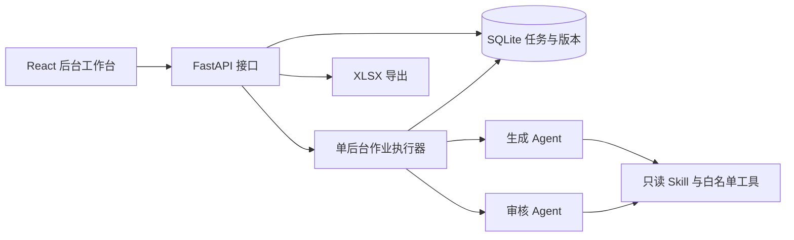
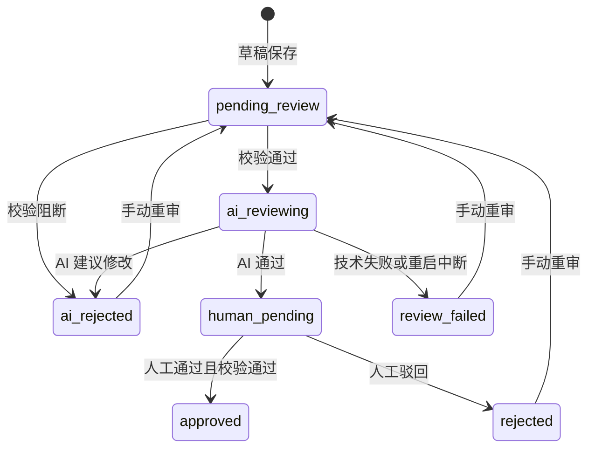

# G2 任务系统 Demo 项目蓝图

> 日期：2026-10-28。状态：可据此拆分实施的设计基线，尚未编码与验收。
> 项目目标：先让真实任务从生成、AI 审核进入人工复查，并能修改、留存版本、通过和导出。

## 1. 本轮决策与验收目标

两位开发者分工：项目发起人负责后端，另一位开发者负责前端。先冻结接口，两端并行；前端使用相同结构的 mock，后端逐项替换为真实能力。文档交付不包含自动开始编码、Git 提交、推送或部署。

已确认的产品方向：

- 一个生成 Agent、一个审核 Agent，二者独立配置和独立上下文。
- 人工审核是首版重点，采用左侧导航、右侧内容区的标准后台布局。
- Python 后端，React + Vite 前端；使用 Deep Agents 承载 Agent 能力。
- 本地个人使用；两个人合作开发代码，不包含运行数据实时共享。

为缩短首版周期，本设计采用以下工程默认值：FastAPI、SQLite、Ant Design；一次只运行一个模型后台作业；前端轮询状态；审核不通过后手动触发修改或重审；不自动反复重做。这些是 Demo 范围约束，后续可以扩展。

验收以同一批 3 条真实任务为主：提供资料 → 生成 → AI 审核 → 人工编辑其中一条并保存 → 对任务通过/驳回 → 导出通过任务。刷新、关闭页面及重启服务后，已保存内容和审核记录仍可读取。模型报错时能定位并重试相应步骤，不把失败当成审核不通过。

## 2. 功能范围

| 能力 | Demo 必须实现 | 后续再做 |
|---|---|---|
| 资料 | 粘贴需求和资料；上传 TXT、MD、CSV、XLSX，预览解析文本 | PDF、Word、图片理解、复杂库存建模 |
| 生成 | 目标、1–10 条数量、普通/长任务、资料引用；默认 3 条 | AI 经理、主题自动分配、多生成员并行 |
| AI 审核 | 一个审核员，按规则逐条给结论、步骤定位和建议 | 双审、多模型投票、自由群聊 |
| 规则工具 | 复用现有 Skill，适配确定性校验、物料提取 | 重建规则引擎、完整物料预算系统 |
| 人工审核 | 列表、筛选、详情编辑、版本、通过、驳回 | 复杂版本树、批量通过、多人锁 |
| 交付 | 导出选中的人工通过版本为三列 XLSX | 自动写外部历史台账、飞书同步 |
| 复盘 | 原稿、修改版本、修改说明、AI 意见、人工决定落库 | AI 聚类、规则候选生效、自动改 Skill |
| 设置 | OpenAI 兼容地址、密钥、生成模型、审核模型 | 多供应商管理、可视化 Agent 编辑器 |
| 可观察性 | 作业阶段、任务状态、结构化错误、刷新恢复 | Token 成本看板、逐 Token 对话流 |

文档中的 G2 领域约束以项目引入的 Skill 快照为准，不能把旧设计的摘要当成最新规则。当前外部速查规则已包含 L-034（磁性物料限制），旧设计附录未覆盖；实施时先引入完整快照并记录哈希。

## 3. 架构与职责

生成和审核分别创建 Agent 实例、提示词和独立运行上下文；审核 Agent 不注册成生成 Agent 的子代理。后端调用顺序为生成、校验、逐条审核；通过明确任务版本和资料快照传参，不共享完整聊天。

Deep Agents 提供 Agent 工具循环、Skill 等运行能力；业务数据库保存任务、版本、审核和人工决定。首版不显式编写 Swarm 拓扑，也不增加消息总线、Redis、Celery。使用该 SDK 不表示默认开启所有能力：实现前必须核验所固定版本的默认委派与工具暴露方式，确保业务模型不能调用子代理或任意 shell。

框架定位依据：[Deep Agents 官方概览](https://docs.langchain.com/oss/python/deepagents/overview)、[SDK 构造与定制](https://docs.langchain.com/oss/python/deepagents/customization)。这些说明支持技术选型，不证明本项目已经集成；具体依赖版本在首个实施批次验证并锁定。

| Owner | 负责 | 不允许绕过的边界 |
|---|---|---|
| API / 应用服务 | 校验输入、事务、版本、状态流转、作业调度 | 前端和模型都不能任意设置任务状态 |
| 生成 Agent | 根据目标和资料生成结构化草稿，按反馈修改 | 无人工通过、规则修改或直接数据库写权限 |
| 审核 Agent | 针对指定版本提交 pass / needs_changes 及证据 | 无任务改写、人工决定权限 |
| 校验适配器 | 输出确定性错误和告警，推导物料 | 不能把语义相似检索包装成精确判定 |
| 人工审核服务 | 保存编辑、决定通过/驳回 | 通过必须针对当前版本且校验无阻断错误 |
| 数据库 | 业务事实唯一来源 | 前端缓存、作业内存及模型文本均不能替代 |

### 3.1 最小后端模块

建议目录为 `backend/app/{api,agents,services,db,tools}`。`services` 内按生成作业、任务版本、审核、导出组织，避免接口函数内堆叠模型与 SQL。`agents` 提供生成与审核两个明确入口；不搭建通用插件框架。

SQLite 保存业务数据；上传与导出文件位于 gitignored 的 `data/`。同一进程内仅允许一个模型作业处于 queued/running；人工读取、编辑其他空闲任务和导出仍可进行。用数据库约束或启动事务保证“检查忙碌并登记作业”原子性，不能仅靠按钮禁用。

首版使用单后端进程，不通过多 worker 启动；模型调用异步执行或移至受控线程，不能阻塞 API。开发热重载或进程退出会中断作业，按第 7 节恢复，不承诺断点续算。

### 3.2 最小业务对象

| 对象 | 必存内容 |
|---|---|
| Attachment | ID、文件名、类型、原文件路径、解析文本、哈希、时间 |
| Batch | ID、目标、数量、任务模式、资料快照、规则快照、创建时间 |
| Task | ID、批次、当前版本、工作流状态、revision、最近错误 |
| TaskVersion | 不可变正文、版本号、父版本、作者类型、修改说明、校验报告、时间 |
| Review | 被审版本、Agent/提示词/模型快照引用、结论、问题、时间 |
| HumanDecision | 被决定版本、通过/驳回、理由、时间 |
| Run | 类型、阶段、状态、关联任务、进度、错误、配置快照 |
| Export | 导出文件、任务版本清单、时间 |
| IdempotencyRecord | 操作标识、请求键、请求摘要、已提交结果 |

作业快照记录模型名、base_url、提示词、规则哈希和资料哈希，不存 API 密钥。附件内容在批次创建时冻结，后续作业读取快照；模型设置在作业开始时冻结。新作业使用新设置，已有版本仍保留生成时配置记录。记录参数不代表 LLM 可逐字复现。

## 4. 用户主流程

1. 设置模型地址、密钥和两个模型名。相同模型可承担两个角色。
2. 资料页上传物料、场景或历史任务文件，查看解析预览；也可以在生成表单粘贴资料。
3. 创建批次，填写明确要求、数量和模式，选择附件。
4. 点击开始。后台生成本批草稿，校验成功后保存；逐条 AI 审核。页面关闭不取消后台运行。
5. 人工审核默认打开“待人工审核”；AI 退回、校验阻断和技术失败在其他页签可见。
6. 打开抽屉，查看当前正文、校验和 AI 意见；修改后保存新版本，再明确点击通过或驳回。
7. 选择已通过任务，导出 XLSX。

生成返回的条数或结构不符合要求时，整次生成不保存部分草稿，作业失败并显示错误。草稿保存后，某条校验不通过进入 AI 退回页签，不调用语义审核；某条模型审核调用失败进入审核失败状态，其他已保存结果保留，并继续处理剩余任务。一个作业存在技术失败时最终标为 failed，页面提示“部分结果已保留”。质量退回不属于技术失败。

不做自动修改循环。用户可手动编辑后重审，或带反馈让生成员重写指定任务；重写形成新版本，随后自动审核。

## 5. 人工审核体验

### 5.1 导航与列表

侧栏包含“任务生成”“人工审核”“资料”“设置”。生成页面显示批次表单、最近批次与作业进度；人工审核页面承担所有任务的分类查看和处理，无需再建设独立 AI 聊天页面。

人工审核页签：待人工审核、AI 退回、审核失败、待 AI 审核、AI 审核中、已通过、人工驳回。数字来自服务端全量过滤结果，不用当前页长度冒充总数。默认按创建时间倒序，可按批次和标题搜索。

表格列：任务名、批次、步骤数、当前版本、状态、是否人工修改、更新时间。空列表提供下一步入口；加载、空态、失败、重试分别呈现。单行点击打开大抽屉，列表保留当前筛选和位置。

### 5.2 详情抽屉

- 主区编辑任务名、逐行步骤和物料。步骤可以增删、上下移动；物料是结构化名称与数量，最终显示汇总文本。
- 侧区显示当前版本校验结果、最近 AI 审核意见和版本记录。AI 意见注明被审版本，不能给人工修改后的版本直接显示“本版本 AI 已通过”。
- 历史版本可只读查看；最少支持 AI 原稿与当前稿并排，不要求复杂移动检测或树形图。
- 修改说明可选填写，用于后续复盘；当前版本与原稿均永久保留。
- 操作包括保存、保存并通过、通过、驳回、重新 AI 审核、按反馈重写。仅按当前状态显示可用操作。

“保存并通过”前端先保存，成功后使用返回的新版本与 revision 调用通过接口。如果第二步失败，显示“版本已保存，通过失败”，保留新稿，不能提示全部失败或自动回滚。

保存无改动时后端返回 `NO_CHANGES`，前端提示“没有需要保存的修改”。表单仍有改动时关闭抽屉或离开页面提示保存/放弃/继续编辑；请求失败保留输入。不能靠失去焦点自动提交决定。

### 5.3 人工与 AI 结论的关系

- 只有 `human_pending` 可以人工通过/驳回。
- 从 `human_pending` 编辑保存后仍保持待人工审核；当前版本校验重新执行，原 AI 审核记录保留在旧版本上。人工可完成最终判断，无需强制重新 AI 审核。
- 从 `ai_rejected`、`review_failed` 或 `rejected` 编辑后仍保留原队列，必须重审通过后进入人工主队列。
- 有确定性阻断错误允许保存，但禁止人工通过；没有“强制覆盖规则”功能。
- 已通过版本锁定，只读；首版不支持重新打开或撤销通过，避免导出后版本歧义。
- 驳回必须写具体理由，记录对应版本。后续重审可以重新进入待人工队列，历史人工决定不删除。

## 6. 状态、并发与接口

任务状态：`pending_review`、`ai_reviewing`、`human_pending`、`ai_rejected`、`review_failed`、`approved`、`rejected`。`editing` 仅为前端表单状态，不落成任务工作流状态。

图中略去了从其他未锁定状态重审以及编辑自环；完整约束见[接口契约](./前后端接口契约.md)。状态迁移由后端服务校验，模型不能直接写状态。

每个任务有递增 `revision`。保存、决定、重审和重写都必须提交预期 revision；不匹配返回 409，保留本地输入并引导重新加载、人工合并。当前作业占用的任务禁止编辑和决定。首次批次作业保存草稿后，在整批结束前占用其全部任务，防止尚未轮到审核的任务被提前编辑。

前端每 2 秒轮询活动作业，结束后停止轮询并刷新任务列表；请求失败展示重试，不高频无限刷新。任务详情与列表在打开页面、完成写操作和作业阶段更新后重新读取。首版不做 SSE 或 WebSocket。

## 7. 失败、恢复与数据保护

| 场景 | 结果 |
|---|---|
| 未配置模型或密钥 | 开始前返回 422，不创建假运行中的作业 |
| 重复点击或 HTTP 响应丢失 | 同一操作使用同一幂等键，返回已提交结果，不重复生成或保存 |
| 已有作业运行 | 新模型作业返回 409 `RUN_BUSY`；读和无关任务编辑可继续 |
| 模型超时、限流、协议或认证错误 | 记录明确错误，作业失败；首版不自动重复收费调用 |
| AI 判定质量不合格 | 正常审核结果，任务为 `ai_rejected`，不标技术异常 |
| 服务重启 | 未结束作业标 interrupted；已保存任务恢复；被中断审核任务改 review_failed |
| 重写时模型失败 | 不新增版本；原正文和状态保留，错误记录在 Run |
| 编辑冲突 | 409，保留用户输入；禁止最后写入者静默覆盖 |
| 导出失败 | 任务状态不变，可重新导出 |

重启时释放旧作业占用；审核中和等待本批审核的任务变为 `review_failed`，附 `RUN_INTERRUPTED`。尚未保存草稿的批次可重新生成，已有草稿的批次禁止整批重新生成，改用任务级重审/重写。首版不从模型半次调用自动续跑。

密钥通过设置页写入本地忽略目录的配置，接口只回 `api_key_set`，日志不包含密钥或完整认证错误响应。仓库只保留配置样例。服务仅监听 `127.0.0.1`；开发代理同源，不开放任意 CORS；仅接受 JSON 的写接口校验内容类型，上传接口校验 Origin/Host，防止外部网页调用本地服务。资料不能作为系统指令执行。

上传限制为单文件 5 MiB、解析文本最多 50,000 字符。XLSX 仅取单元格值和表头，不执行公式/宏/外链，限制总单元格数 20,000；超限或公式内容需要参与理解时明确报错。批次资料文本（含附件）最多 80,000 字符，超限要求缩减，不静默截断。这些限制旨在限制首版解析与上下文成本，不代表已完成库存审计。

## 8. 扩展边界与回退

后续增加经理或多个生成员时，扩展调度及 Agent 配置即可；任务、版本、审核和人工页面继续复用。当前内部记录固定角色标识 `generator-default`、`reviewer-default`，无需提前做 Agent 管理页面。

当前失败可回退为用户在页面保留资料并手动重试，不用 mock 数据替代真实结果。前端 mock 必须明确标识，关闭 mock 才能进行正式联调。规则快照只读，外部 Skill 和历史台账不被 Demo 修改；导出只生成文件及导出记录。

几个小时是开发目标，不是已验证工期。若模型兼容性阻塞，先打通一个生成/审核真实调用，再完善列表；不能把 mock 流程通过写成真实验收。所有待执行项与 Owner 见[双人实施清单](./双人实施清单.md)。
