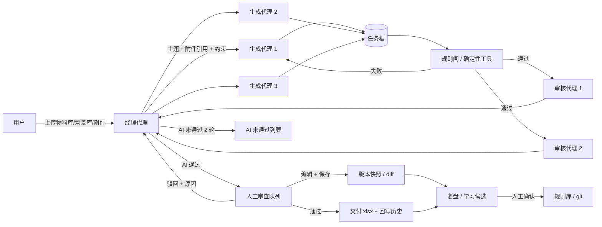

# G2 任务生成工作流系统 — 产品与架构设计（v0.1）

> 文档状态：需求讨论稿，待用户与复查 AI 审核；尚未开始编码。
> 阅读对象：项目发起人、合作开发者、复查 AI。
> 一句话：把现有 `g2-robot-task-designer-v2` skill 的 SOP 产品化成一个本地 Web 工作流系统，用 LangGraph + deepagents 承载独立代理协作，用确定性工具守住硬规则，用人工复核做最终裁决，用编辑 diff 驱动可审计的规则进化。

---

## 目录

- [0. 摘要](#0-摘要)
- [1. 背景与问题](#1-背景与问题)
- [2. 原始需求整理](#2-原始需求整理)
- [3. 决策记录与解释](#3-决策记录与解释)
- [4. 产品设计](#4-产品设计)
- [5. 技术架构](#5-技术架构)
- [6. 首版竖切范围](#6-首版竖切范围)
- [7. 风险、开放问题与复查清单](#7-风险开放问题与复查清单)
- [8. 附录](#8-附录)

---

## 0. 摘要

### 0.1 结论

这个系统可行，而且不是从零开始：现有 skill 已经沉淀了规则库、校验脚本、历史台账和回归用例。系统要做的是把这些资产变成可观测、可回放、可进化的“工作台”，而不是重新发明一套提示词。

最终形态是五句话：

1. **代理负责判断和协作，工具负责确定性事实。** 流程不由脚本写死；步数、禁用词、命名、物料汇总、去重、导出、回写由代理按需调用工具完成。
2. **对话负责协作，任务板负责状态。** 聊天记录不是唯一状态源；所有任务、版本、审核、人工决定都落库，支持暂停、恢复、回放。
3. **Swarm 负责对话，并行 fan-out 负责生成。** `langgraph-swarm` 同一时刻只有一个活跃代理，3 个生成代理要同时工作，必须用 LangGraph `Send` 或 deepagents 的异步子代理另行扇出。
4. **AI 只做初筛和标注，人工做最终裁决。** AI 审核通过的任务才进入人工审查列表；AI 未通过的任务自动重做，最多 2 轮，仍不过进入单独的“AI 未通过”列表。
5. **学习不自动改规则。** 人工编辑和驳回先形成信号，复盘代理聚类成规则/案例候选，人工确认后走 `learn.py` → `regression.py` → 历史回放，再升版本并进入 git。

### 0.2 当前状态

| 项目 | 状态 |
|---|---|
| 需求讨论 | 已收敛到可开工 |
| 技术底座 | 已确定：LangGraph + deepagents；通信先 Swarm |
| 首版形态 | 直接做端到端竖切；本文档先评审 |
| 代码 | 尚未开始 |
| 待确认项 | 见 3.5 与 7.3 |

---

## 1. 背景与问题

### 1.1 现在怎么做

当前用 `g2-robot-task-designer-v2` skill 生成 G2 双臂机器人遥操作采集任务。这个 skill 已经是一套成熟的 SOP：

- 读速查规则（`references/06-brief.md`），排除夹爪做不了的工具和场景；
- 确定现实工作目标、初始状态、最终状态；
- 按真人顺序写动作链，一步一个动作；
- 用 `scripts/check.py` 做命名、步数、禁用词、括号、物料一致性、连续段重叠、历史近似检查；
- 用 `assets/delivered_tasks.txt` 和飞书已有任务名单去重；
- 6 条以上导出 xlsx，交付后追加历史台账；
- 用户提出修改意见后，按 `references/07-evolution.md` 把意见沉淀成规则。

### 1.2 现有资产

| 资产 | 位置 | 规模/作用 |
|---|---|---|
| 主规则 | `skills/g2-robot-task-designer-v2/SKILL.md` | 约 14 KB，核心原则与执行流程 |
| 速查规则 | `references/06-brief.md` | 每次出题前必读的生效规则 |
| 能力约束 | `references/01-capability.md` | 夹爪、工位、场景、液体等边界 |
| 写法与审核 | `references/02-writing-and-review.md` | 一步一动作、终态、复合任务审核 |
| 去重 | `references/03-diversity.md` | 同构判断、核心段复用、物料泛化 |
| 进化流程 | `references/07-evolution.md` | 捕获、提炼、查重、落地、回归 |
| 校验脚本 | `scripts/check.py` 等 | 规则校验、连续段重叠、历史近似 |
| 学习脚本 | `scripts/learn.py` | 规则编号、查重、状态流转、速查生成 |
| 回归脚本 | `scripts/regression.py` | 通过案例必须过，坏例必须被拦 |
| 已交付台账 | `assets/delivered_tasks.txt` | 约 443 行历史任务与核心动作链 |
| 飞书名单 | `assets/existing_tasks_feishu.txt` | 362 条已有任务名（整理于 2026-10-20） |
| 回归用例 | `assets/regression_cases.csv` | 465 行（含表头） |
| 原子能力标签 | `assets/atomic_skills_catalog.csv` | 126 个标签 |

### 1.3 痛点

1. **批量效率低。** 每条任务都要重复读规则、查历史、跑脚本、改格式，人工串行推进。
2. **模型容易漏规则。** 步数、禁用词、命名、括号、物料汇总、去重这些确定性要求，靠模型“记住”不可靠。
3. **AI 审查不可信。** 单次 LLM 审核容易误杀或漏放，缺少证据链、分歧处理和人工终审。
4. **人工修改无法沉淀。** 改完就结束，diff 没有结构化保存，下一次还会犯同样的错。
5. **三方数据割裂。** 生成、审查、人工复核各自为战，任务状态、版本、原因、规则变更无法统一回放。
6. **物料/场景数据没有强约束。** 生成端容易编造库存、颜色、结构；五套能否配齐无法在生成时校验。

### 1.4 目标与非目标

**目标**

- 一个本地 Web 工作台，左侧栏组织生成、AI 审查、人工审查、资料库、复盘进化、代理管理、设置。
- 用户上传物料库、场景库、历史任务/附件；经理代理调查、定主题、分配；3 个生成代理并行出题；2 个审核代理初筛；人工终审。
- 每条任务有完整版本树：AI 原稿、每次人工修改、最终通过版；diff 结构化保存。
- 人工编辑和驳回形成学习信号；复盘代理生成候选；人工确认后规则进 git，回归和历史回放通过才生效。
- 本地 `.bat` 一键启动；代码仓库可发 GitHub，两人协作开发。

**非目标（首版不做）**

- 不做 G2 机器人控制、仿真、真实采集执行。
- 不做公网部署、多租户、复杂权限体系（首版个人使用）。
- 不做模型微调；学习通过规则、案例和提示词完成。
- 不做自动改规则；规则必须人工确认。
- 不做自动生成视频、自动标注、自动训练。
- 不做飞书双向同步（可作为后续可选）。
- 不追求“全自动无人值守”；人工终审是设计的一部分。

---

## 2. 原始需求整理

> 说明：原始需求来自口述转文字，存在少量转写误差（例如“微本系统”应为“工作流系统”，“子 agent”后来被明确纠正为“独立代理”）。下面先给整理版，再保留关键原话，避免曲解。

### 2.1 初始需求（整理版）

**背景**

- 现在用 `g2-robot-task-designer-v2` skill 生成 G2 任务，skill 已经把要求凝练成 SOP。
- 但一直这样太麻烦，效率不够高，模型出错问题比较大。
- 希望做成一个工作流系统，配一个 Web 界面。

**三个模块**

1. **任务生成模块**：AI 驱动，输入专门定制好的数据，生成任务。
2. **任务审查模块**：AI 驱动，做 AI 初筛。
3. **人工复核模块**：独立模块，对每条任务通过或驳回；驳回必须给出具体理由。

**输入与组织方式**

- 用户人工必须上传物料库、场景库，或者一些特定的场景。
- 设计一个“总管/经理”AI，根据收到的内容合理分发给多个任务生成代理（生成员）。
- 生成后由多个审查代理做 AI 初筛。
- 结果汇总到人工复查列表，由人工复查。
- 生成和审查使用的 skill 具备自学习、自进化能力。

**人工复核的关键行为**

- AI 初筛后的任务可能还有微小错误，人工不直接驳回，而是直接修改。
- 修改前的版本形成快照，修改后的版本也保留。
- 这是一个可复盘的项目；AI 结果与用户最终预期之间的微调过程也可以学习。

### 2.2 后续补充（整理版）

| 主题 | 补充内容 |
|---|---|
| 使用范围 | 目前个人使用；仓库会发到 GitHub，和一位朋友两人合作开发；本地运行，整理成 `.bat` 一键启动；还没到团队使用程度。 |
| 模型接入 | OpenAI 兼容 API 即可；输入 API 后，可自定义选择模型、URL、服务商。 |
| 编排方式 | 不要用脚本把流程写死；要自由多代理对话，类似 Swarm 的多 Agent 协作。 |
| 代理关系 | 经理代理和生成代理不是上下级；本质是不同独立代理；每个代理是一份提示词，像人给 AI 提示词。 |
| 经理职责 | 先调查、思考、分析，选出合适主题，整理好后与生成代理交互；把附件引用告诉生成代理。 |
| 生成代理 | 例如 3 个；拿到经理给的附件引用、当前任务等资料后生成任务。 |
| 审核代理 | 生成后交给审核代理；审核代理也需要原始文案和对应提示词；经理负责监督。 |
| 人工审查 UI | 左侧边栏系统；人工审查模块列出所有“AI 已生成且经 AI 审核员审核通过”的任务；每行显示标题等信息。 |
| 人工编辑 | 点击任务弹出小窗口，包含任务名字、步骤、所需物料，全部可编辑；步骤修改后点击保存。 |
| 保存的意义 | 保存动作是为了给 AI 复盘，记录进化过程。 |
| 技术底座 | 不是从零，基于 LangGraph、deepagents 框架。 |
| 通信形态 | 先 Swarm，待定，还需和团队协商。 |
| 生成并发 | Swarm 对话 + 并行生成。 |
| 学习闭环 | 候选 + 人工确认。 |
| AI 未通过 | 自动重做，仍不过进列表。 |
| 首版交付 | 直接做竖切；但先交付本文档。 |
| 规则库位置 | 仓库内 `skills/`。 |
| 前端 | React。 |

### 2.3 需求边界

**必须满足**

- 三模块：生成、AI 审查、人工审查。
- 用户上传物料库、场景库/特定场景。
- 经理 + 多个独立生成代理 + 多个审核代理。
- 人工审查只列 AI 审核通过的任务；可编辑名字、步骤、物料；保存形成版本快照，可复盘。
- 学习来自人工修改和驳回，但规则变更要可控。
- 本地运行、一键启动、GitHub 双人协作。
- 基于 LangGraph + deepagents。

**明确不要求**

- 不要求无人值守全自动。
- 不要求 AI 直接改规则并立即生效。
- 不要求首版支持多人权限、公网、移动端。
- 不要求接入真实机器人执行。

---

## 3. 决策记录与解释

> 这一节是本文档的重点。你把很多问题都选了“选项一”，但选项一之间其实有依赖关系，也有代价。下面逐条解释“你选了什么、这意味着什么、为什么它排在选项一、代价是什么、如果反悔怎么改”。

### 3.1 决策总表

| 编号 | 问题 | 你选的 | 实际含义（一句话） | 影响 |
|---|---|---|---|---|
| D1 | 首版给谁用 | 个人使用、本地、GitHub 双人、`.bat` | 不做账号权限，SQLite 本地存，朋友各自跑一份 | 部署最简单；多人协作是后续升级 |
| D2 | 模型怎么接 | OpenAI 兼容 API，可配 URL/模型/服务商 | 后端用统一适配层，随时换供应商 | 不锁厂商；但工具调用能力因供应商而异 |
| D3 | 编排形态 | 自由多代理、独立代理，不是固定流水线 | 经理决定主题和分配，代理各有提示词和上下文 | 灵活；但需要护栏、日志和预算 |
| D4 | 脚本边界 | 代理编排 + 确定性工具 | 流程由代理决定；校验/去重/导出/回写是工具 | 保住 skill 的可靠性；工具不能变成隐藏流程 |
| D5 | 代理通信 | 先 Swarm，团队待定 | 初期用 `langgraph-swarm` 的活跃代理交接 | 单活跃代理，天然不并行 |
| D6 | 生成并发 | Swarm 对话 + 并行生成 | 对话用 Swarm；3 个生成代理用 fan-out 并行 | 保留 Swarm 体验，同时提高吞吐 |
| D7 | 学习闭环 | 候选 + 人工确认 | diff/驳回先聚类成候选，人确认后才写规则 | 防规则漂移；需要人工投入 |
| D8 | AI 未通过 | 自动重做最多 2 轮，仍不过进列表 | 审核代理驳回后生成代理带反馈重做 | 省人工；但耗 token，AI 可能误判 |
| D9 | 首版交付 | 直接做竖切 | 真实端到端跑通一条链路，不做纯 mock | 最快看到可用系统；范围要收紧 |
| D10 | 规则库位置 | 仓库内 `skills/` | 规则变更 = git commit，朋友拉下来就能跑 | 可回放；需要和外部 skill 同步 |
| D11 | 前端栈 | React | React SPA + Vite + AntD | 后台工作台开发快；不做 SSR |
| D12 | 人工审查交互 | 左侧栏列表 + 弹窗编辑 + 保存快照 | 只列 AI 通过；保存生成新版本；另设通过/驳回 | 符合你的描述；保存≠通过需确认 |
| D13 | 技术底座 | LangGraph + deepagents（+ langgraph-swarm） | 复用图运行时、状态、技能、子代理；不自研 | 快；但框架耦合、版本迭代快，需要 POC |

### 3.2 逐条解释

#### D1：首版给谁用

**你选了什么**

个人使用；仓库发 GitHub，和一位朋友合作开发；本地运行，`.bat` 一键启动。

**实际含义**

- 首版不做登录、角色、权限、任务分配。
- 数据库用 SQLite，文件和快照存本地目录。
- 你和朋友各自跑一份，数据默认不共享；GitHub 共享的是代码，不是运行数据。
- `.bat` 负责建虚拟环境、装依赖、构建前端、启动后端、打开浏览器。

**为什么它排在选项一**

这是当前规模下成本最低、最快能跑起来的方案。先把系统做出来、用起来，再考虑多人共享，不会一上来被权限和部署拖住。

**代价与边界**

- 两个人同时改规则文件可能冲突，需要 git 流程。
- 本地 SQLite 不适合多人同时写；将来升级多人要换 Postgres 并加认证。
- 朋友电脑上的模型配置、文件路径、Python/Node 版本要各自配好。

**如果反悔**

局域网多人需要加账号、角色、共享数据库、任务分配和并发控制；公网还需要部署、安全、备份。数据模型和服务边界已经按可升级方式设计，但升级不是零成本。

---

#### D2：模型怎么接

**你选了什么**

OpenAI 兼容 API；输入 API 后可配置模型、URL、服务商。

**实际含义**

- 后端用统一的 OpenAI 兼容客户端（LangChain 的 `ChatOpenAI` 或等价适配器）。
- 设置页保存 `base_url`、`api_key`、`model`、温度、并发等；可以给经理、生成、审核分别配不同模型。
- API key 只存本地 `.env` 或本地配置，不进 git、不进日志。

**为什么它排在选项一**

DeepSeek、Qwen、GLM、OpenAI 兼容网关都能接；换供应商不用改业务代码。对个人和双人开发最灵活。

**代价与边界**

- 不同供应商对 function calling、JSON 结构化输出、流式的支持不一致；需要能力探测和降级协议。
- 模型版本变化会影响可复现性；批次要记录模型名和参数。
- 本地 Agent CLI 方案不选，因为它依赖已登录运行时，并发和结构化输出更难控。

**如果反悔**

Anthropic 原生或本机 CLI 都可以作为适配器加进来，但会增加一套调用路径和测试成本。

---

#### D3：编排形态

**你选了什么**

自由多代理对话；经理和生成代理是独立代理，不是上下级；每个代理是一份提示词；不要用脚本把流程写死。

**实际含义**

- 没有固定的“先生成 A，再生成 B，再审核 C”的脚本序列。
- 经理根据用户目标、物料库、场景库、附件，自己决定主题、分配、找谁审核、是否重做。
- 每个代理有自己的系统提示词、模型、工具和上下文；默认上下文隔离，不共享全部聊天。
- 经理是协调者，不是老板；它负责对接用户和路由，但不拥有其他代理。
- 系统仍然有运行时图、任务板和护栏，但图定义的是“房间里有谁”，不是“每一步必须做什么”。

**为什么它排在选项一**

这是你明确想要的产品感觉：像和一位经理对话，它自己调查、思考、分派，而不是点一个按钮跑固定流水线。模型能力足够、上下文不长、分工明确时，这种形态更自然。

**代价与边界**

- 非确定性：同一输入可能得到不同主题和任务；需要批次快照和重跑。
- 成本和延迟：多代理对话比单次调用贵；需要预算、轮次上限、停止按钮。
- 重复和跑偏：并行生成可能撞题；必须有全局判重和任务板。
- 调试难：对话是自然语言，必须把工具调用、任务状态、版本全部落库，不能只靠聊天记录。
- “独立代理”不等于“没有协调”；经理仍然要分配和汇总，否则会变成一盘散沙。

**如果反悔**

固定流水线更可控、更便宜，但会牺牲你要的灵活性。当前设计把拓扑放在图层面，业务层（任务板、工具、UI）不绑定拓扑，切换成本可控。

---

#### D4：脚本边界

**你选了什么**

代理编排 + 确定性工具。同一轮你还补充了技术底座：LangGraph + deepagents（见 D13）。

**实际含义**

- 流程由代理决定：谁生成、什么主题、找谁审、要不要重做。
- 工具只做确定性事实：步数、禁用词、命名、括号、物料汇总、历史去重、xlsx 导出、`delivered_tasks` 回写、文件解析。
- 代理自己决定何时调用工具；工具返回事实和错误，不决定下一步。

**为什么它排在选项一**

这正是模型最容易出错的地方：数 12 步、查禁用词、保持括号一致、汇总物料、判断历史同构。现有 `check.py`、`materials.py`、`lookup_history.py`、`export_xlsx.py` 已经经过大量任务和回归用例验证；把它们删掉，等于让审核代理用肉眼数步数。

需要澄清：`check.py` 不是“流程脚本”，它不规定下一步做什么，只回答“这条任务有没有硬错误”。你反对的是脚本编排流程，不是确定性校验。

**代价与边界**

- 工具要设计好输入/输出，不能把工具调用变成隐藏的固定流程。
- 代理可能忽略工具结果；审核代理和人工仍要兜底。
- 现有脚本有的带 CLI/文件 IO，需要重构成可导入的纯函数，或在工具层用临时文件封装。
- 工具本身也可能有 bug；用回归用例保护。

**如果反悔**

完全不用脚本，所有检查交给审核代理：系统更“纯 Agent”，但硬规则漏检率会上升，回归资产失效。只让脚本做存取、不做校验：介于两者之间，但同样放弃确定性优势。

---

#### D5：代理通信

**你选了什么**

先 Swarm，待定，还需和团队协商。

**实际含义**

- 初期用 `langgraph-swarm`：`create_swarm` + `create_handoff_tool`，维护 `active_agent`，代理之间交接控制权。
- 默认活跃代理是经理；生成/审核代理完成后可以把控制权交回经理。
- 必须配 checkpointer，才能多轮、暂停、恢复。

**为什么它排在选项一**

最接近你说的“类似 Swarm 的多 Agent 协作”；实现比自研消息总线简单，LangGraph 原生支持状态和恢复。

**代价与边界**

- Swarm 同一时刻只有一个活跃代理，是顺序对话，不是并行工作池。
- 交接的是控制权，不是“发消息后继续各干各的”；上下文如何传递要设计。
- 团队协商如果改成 supervisor 或其他拓扑，需要换图，但任务板和 UI 可以不变。

**如果反悔**

群聊式 Agent Room 或经理中心转发都可以作为替代；前者更独立，后者更可控。建议把拓扑做成可切换，不要把它写死在前端和数据库里。

---

#### D6：生成并发

**你选了什么**

Swarm 对话 + 并行生成。

**实际含义**

- Swarm 负责经理、生成代理、审核代理之间的对话和交接。
- 3 个生成代理的实际生成工作用 LangGraph `Send` 扇出，或 deepagents 的异步子代理并行执行。
- 每个生成代理独立 thread/context，结果写回同一任务板；经理聚合。

**为什么它排在选项一**

纯 Swarm 顺序会让 3 个生成代理排队，批次慢；纯 supervisor 并行又更像上下级，失去 Swarm 的感觉。混合方案保留对话体验，同时提高吞吐。

**代价与边界**

- 这是混合架构，不是“纯 Swarm”；需要额外的扇出、聚合、锁和判重。
- 并行写入任务板要防冲突：SQLite 用 WAL + 单写队列/事务；同一槽位只能一个代理写。
- 全局判重必须在聚合后做一次，不能只靠每个代理自己查历史。
- 需要 POC 验证 `langgraph-swarm` + deepagents 的集成方式，不能假设一定顺滑。

**如果反悔**

纯 Swarm 顺序：先跑通，慢但简单。deepagents supervisor：并行最顺，但更上下级。两者都可以在任务板/UI 不变的前提下替换。

---

#### D7：学习闭环

**你选了什么**

候选 + 人工确认。

**实际含义**

- 人工编辑保存时，记录结构化 diff、编辑人、时间、当时的规则/提示词/附件版本，可选填修改原因。
- 批次结束或手动触发时，复盘代理把 diff 和驳回理由聚类，生成规则候选和案例候选。
- 候选必须由人确认，才写入规则库；写入后跑 `regression.py` 和历史回放，展示影响面，再升版本。

**为什么它排在选项一**

单次编辑可能只是一次性措辞调整，直接自动写规则会把规则库带偏，越管越死。候选 + 人工确认能保留学习能力，又不失去控制。

**代价与边界**

- 需要人投入审核候选；候选太多会疲劳。
- 聚类质量取决于复盘代理；需要证据链和可追溯来源。
- 规则生效后可能误杀历史通过任务；必须做历史回放，必要时回滚。

**如果反悔**

自动生效 + 回归兜底：省事，但单次偏好容易污染规则库。只存 diff 不改规则：最稳，但学习慢。

---

#### D8：AI 未通过

**你选了什么**

自动重做，仍不过进列表。

**实际含义**

- 审核代理判不通过 → 把意见反馈给生成代理 → 生成代理重做，最多 2 轮。
- 2 轮后仍不通过 → 进入“AI 未通过”列表，不进入人工审查主列表；人工可以抽查。
- 人工审查主列表只列 AI 审核通过的任务。

**为什么它排在选项一**

人工时间宝贵；明显不达标的任务先让 AI 自己改，能减少人工队列噪音。保留“AI 未通过”列表，避免黑箱丢掉。

**代价与边界**

- 重做消耗 token；如果审核代理误判，会浪费两轮。
- “通过”的定义要明确：多个审核代理全部 pass 才算通过；有分歧时由经理裁决或第三审。
- AI 未通过列表需要有入口，否则无法复盘误杀。

**如果反悔**

直接进人工列表：人工负担大，但不会漏。直接淘汰：最省，但误杀风险最高。

---

#### D9：首版交付

**你选了什么**

直接做竖切；但先交付本文档。

**实际含义**

- 本文档评审通过后，直接做真实端到端的最小闭环，不做纯 mock、不做只可点击的原型。
- 竖切范围：上传库 → 建批次 → 经理规划 → 3 个生成代理并行 → 规则闸 → AI 审查 → 人工列表 → 编辑/保存/通过 → 导出 → 一条学习候选。
- 先不做：多用户、复杂看板、飞书同步、图片理解、自动规则生效。

**为什么它排在选项一**

最快看到可用系统，也能最早暴露 LangGraph/deepagents/Swarm 的集成问题。纯 POC 或纯 UI 原型都会延后真实反馈。

**代价与边界**

- 范围容易膨胀；必须严格按第 6 节的验收标准做。
- Swarm 与并行生成的集成风险仍在；竖切里要留一个可降级的顺序模式。
- 文档评审不通过时，先改文档，不开始写代码。

**如果反悔**

POC 对比两种拓扑：更稳，但慢。UI 原型先定交互：更适合先对齐视觉，但后端风险延后。

---

#### D10：规则库位置

**你选了什么**

仓库内 `skills/`。

**实际含义**

- 仓库自带 `skills/g2-robot-task-designer-v2/`，包含 `SKILL.md`、`references/`、`scripts/`、`assets/`。
- 规则变更写入仓库文件，形成 git diff；朋友拉下来即可复现。
- 外部 `.agents/skills/...` 作为上游，定期同步；避免两边同时改造成分叉。
- deepagents 通过 `skills=["./skills/"]` 加载；`/skills/` 只读，`/data/` 可写。

**为什么它排在选项一**

GitHub 双人协作需要可复现的规则版本；规则变更进 git，天然可回放、可审查、可回滚。也符合“批次锁定规则版本”的要求。

**代价与边界**

- 规则文件和代码在同一个仓库，PR 里会混有规则变更；需要约定提交规范。
- 应用写入规则后，是否自动 commit 要定；建议应用写文件并展示 diff，由人确认后提交。
- 外部 skill 和仓库 skill 可能分叉，需要同步脚本和冲突处理。
- deepagents skills 每个 thread 只加载一次；规则改了要开新批次/新 thread。

**如果反悔**

引用外部目录：仓库轻，但朋友环境不一致、学习写入不在 git 里。双向同步：两边都能改，但复杂度最高。

---

#### D11：前端栈

**你选了什么**

React（选项一，React + Vite + AntD）。

**实际含义**

- 单页应用；FastAPI 提供 REST + SSE；Vite 构建；AntD 提供表格、弹窗、抽屉、表单、主题。
- 本地运行时，FastAPI 可以托管构建后的静态文件，避免起两个服务。
- 开发时前端热更新，后端 `uvicorn --reload`。

**为什么它排在选项一**

这是一个后台工作台，表格、队列、弹窗、diff、流式日志是主界面；AntD 现成组件多，开发快。SSR 对这些页面没有价值。

**代价与边界**

- 没有 SSR；本地工具不需要。
- 前端构建产物要纳入 `.bat` 启动流程。
- 复杂 diff/版本树需要额外组件或自研。

**如果反悔**

Next.js 更重；团队已有栈则以团队为准。React 本身不是强绑定，API 层不变。

---

#### D12：人工审查交互

**你选了什么**

左侧栏；“人工审查”只列 AI 审核通过的任务；每行显示标题等信息；点击任务弹出小窗口，任务名、步骤、物料可编辑；修改步骤后点击保存；保存用于 AI 复盘和进化记录。

**实际含义**

- 人工审查是一个独立模块，不和 AI 审查混在一起。
- 列表只展示 AI 审核通过的任务；AI 未通过的进入另一个列表/页签。
- 弹窗（建议大弹窗或右侧抽屉）里，名字、步骤、物料都可编辑；步骤是逐行编辑，可增删、调整顺序。
- 保存会创建新版本，保留 AI 原稿和每次人工修改，记录结构化 diff。
- 保存本身不自动通过；另设“通过”和“驳回”。这是当前假设，待确认（见 3.5）。

**为什么它排在选项一**

这最符合你的描述：人工不是在聊天里改，而是在结构化表单里改；保存不是为了覆盖，而是为了留下可复盘的版本树。

**代价与边界**

- 保存≠通过，可能和你“点保存就行了”的直觉不一致；如果希望保存即通过，可以改，但会少一道显式闸门。
- 每次保存都跑规则闸，硬错误要提示；是否允许带错误保存，需要定。
- 版本树和 diff 会增加 UI 复杂度，但这是复盘和学习的基础。

**如果反悔**

保存即通过：操作更短，但人工可能误点；把通过/驳回放到列表批量操作：效率高，但容易漏看。

---

#### D13：技术底座（LangGraph + deepagents）

**你选了什么**

系统不是从零，基于 LangGraph 和 deepagents；通信先 Swarm，后续和团队协商。

**实际含义**

- LangGraph 负责运行时：图、state、checkpointer、流式、interrupt/resume。
- deepagents 负责单个代理的能力：规划、虚拟文件系统、skills 渐进加载、subagents、工具调用。
- langgraph-swarm 负责代理间交接：`create_swarm`、`create_handoff_tool`、active agent。
- 现有 skill 作为 deepagents 的 skill 加载，脚本包成工具；不是把 skill 重写成另一套 prompt。

**为什么它排在选项一**

复用成熟运行时，避免自研状态机、恢复、流式和工具调用；deepagents 的 skills 正好对上现有 `SKILL.md` 目录；LangGraph 的 checkpointer 和 interrupt 适合“暂停/恢复/人工介入”。

**代价与边界**

- 框架耦合：deepagents/LangGraph 迭代快，版本要固定，升级前跑 POC/回归。
- deepagents 默认是 supervisor + subagents，偏上下级；你要的独立代理/Swarm 需要额外集成（见 D5、D6）。
- langgraph-swarm 单活跃代理，不能天然并行；并行生成要另做 fan-out（见 D6）。
- 学习曲线和调试成本：图、checkpoint、handoff、tool calling 都要可观测。
- 需要 POC 验证 `langgraph-swarm` + deepagents 的集成；不能假设一定顺滑。

**如果反悔**

纯 LangGraph 自研代理循环：更可控，但工作量大；纯 deepagents supervisor：最快，但更上下级；纯 Swarm：最简单，但并行弱。三者都可以在任务板/UI 不变的前提下替换。

---

### 3.3 我的决策行为

你提到“很多问题并没有完全理解，只是觉得选项一最符合想法”。这一节解释我在什么情况下问你、什么情况下替你定、什么情况下会反对，以及你多次选选项一时我是怎么处理的。

#### 3.3.1 我为什么会问那些问题

你的需求同时涉及产品方向、代理架构、UI、数据、学习闭环，很多选择是不可逆或高成本的。我问的问题分三类：

1. **产品方向**：给谁用、首版交付什么、人工审查怎么操作。这些会决定 UI 和数据模型。
2. **高成本架构**：模型接入、编排形态、通信拓扑、生成并发、脚本边界。这些选错会重写。
3. **治理边界**：学习是否自动生效、AI 未通过怎么处理、规则库放哪。这些会决定系统是否可信。

我没有问的，多数是可逆的技术默认值，例如数据库、SSE、目录结构、API 形状。

#### 3.3.2 我替你定的技术默认值

| 默认值 | 我的选择 | 理由 | 可改性 |
|---|---|---|---|
| 后端 | Python + FastAPI | 直接复用 skill 的 Python 脚本；LangGraph/deepagents 都是 Python 生态 | 中 |
| 数据库 | SQLite（WAL） | 本地单用户，零运维 | 容易换 Postgres |
| 图状态 | LangGraph checkpointer（SQLite） | 暂停/恢复/回放 | 中 |
| 流式 | `astream_events` → SSE | 前端实时看消息、工具调用、任务板 | 容易换 WebSocket |
| 任务板 | 独立 SQLite 表，作为唯一真源 | 聊天不是状态；并行写入要可恢复 | 难改，属于核心 |
| 人工审查 | DB 队列 + 独立页面 | 不给每个任务挂 interrupt，避免几百个挂起图 | 难改，属于核心 |
| 工具 | 包装现有脚本，不开 shell | 安全、确定、可测试 | 中 |
| skill 目录 | 只读；data 可写 | 防止代理改规则；规则变更走人工确认 | 难改，属于安全边界 |
| 代理数量 | 3 生成 + 2 审核 | 符合你的示例；可配置 | 容易 |
| AI 重做 | 最多 2 轮 | 成本和质量折中 | 容易 |
| 批次快照 | 规则/提示词/物料库/场景库/模型参数 | 可复现、可归因 | 难改，属于核心 |
| 交付 | xlsx 三列 + 追加 `delivered_tasks` | 沿用现有 skill 的交付规范 | 容易 |
| 首版权限 | 不做 | 个人使用 | 中 |

#### 3.3.3 我明确反对或保留的四件事

1. **完全不用脚本。** 我保留了确定性工具。理由：模型不擅长精确计数、禁用词、括号、物料汇总、历史判重；现有脚本和回归用例是资产。
2. **AI 做最终裁决。** 我坚持人工终审。AI 只做初筛、标注、分流；误杀比不审更伤。
3. **编辑后自动写规则。** 我坚持候选 + 人工确认。单次编辑可能是一次性偏好；自动写规则会让规则库膨胀、漂移。
4. **纯 Swarm 并行。** 我指出 `langgraph-swarm` 是单活跃代理，不能天然并行；因此采用“Swarm 管对话 + 并行 fan-out 管生成”的混合方案。

#### 3.3.4 你多次选选项一，我是怎么处理的

- 我把选项一当作“你认可的方向”，但没有把它当成“你已经完全理解的合同”。因此本文档把每个选项的实际含义、代价和可逆性写出来。
- 选项一之间并非完全独立。例如“自由多代理”（D3）+“先 Swarm”（D5）+“3 个生成代理并行”（需求）会撞上 Swarm 的单活跃限制；所以才有 D6 的混合方案。
- 如果你的本意不是选项一的字面含义，按 3.5 的待确认项纠正；我会先改文档，再改实现。
- 我没有替你决定：团队最终拓扑、UI 视觉风格、具体提示词、物料/场景库字段、保存是否等于通过、AI 未通过列表是否要主入口。

#### 3.3.5 哪些决定是“真决定”，哪些只是“暂定”

- **真决定**（改动成本高）：任务板作为唯一真源、版本树/diff、人工终审、规则候选+人工确认、skill 只读、批次快照。
- **技术底座**（你指定，集成方式待 POC）：LangGraph + deepagents + langgraph-swarm；框架本身不再讨论，但“怎么接”要验证。
- **暂定**（可随团队讨论改）：Swarm vs supervisor、并行 fan-out 的具体实现、审核代理数量、前端 UI 风格、是否接飞书。
- **技术默认**（可替换）：SQLite、SSE、目录结构、API 形状、AntD。

### 3.4 可逆性分级

| 级别 | 内容 | 说明 |
|---|---|---|
| 容易改 | UI 主题、表格列、文案、AntD 组件、模型供应商、代理数量、重做轮数、预算阈值 | 不影响数据模型 |
| 中等 | Swarm ↔ supervisor、并行 fan-out 实现、审核 rubric、提示词结构、SSE ↔ WebSocket、SQLite ↔ Postgres | 需要改图和适配层，但任务板/UI 可保留 |
| 难改 | 任务/版本/审核/人工决定的数据模型、版本树与 diff 语义、skill 只读边界、规则候选+人工确认流程、批次快照 | 一旦大量数据写入，迁移成本高 |

### 3.5 待确认清单

以下问题不影响本文档成立，但会影响实现细节，建议在开工前确认：

1. **保存是否等于通过？** 当前设计：保存 = 新版本，不自动通过；另有通过/驳回。若你希望保存即通过，需要调整人工审查流程。
2. **“AI 未通过”列表是否要给主入口？** 当前设计：不进入人工审查主列表，但在任务审查/批次报告里可查。
3. **审核代理数量与分工？** 当前默认 2 个：能力/安全、真实用途/终态。是否要第三个（去重/格式）或多模型投票？
4. **物料库、场景库的字段和样例？** 需要你提供现有文件或口述字段；否则我先按第 5.5 节的 schema 设计，页面上录入。
5. **规则候选生效后是否自动 git commit？** 当前建议：应用写文件并展示 diff，由人确认提交；也可配置自动提交。
6. **首版是否需要接飞书？** 当前不做双向同步；历史名单可作为只读导入。
7. **单批规模与预算？** 例如一次 6/20/50 条；每批 token/费用上限；并发数。
8. **UI 风格？** 当前未定；建议在竖切后做一版双主题（浅色/深色）工作台稿再定。

---

## 4. 产品设计

### 4.1 角色与职责

| 角色 | 职责 | 不做什么 |
|---|---|---|
| 用户 | 上传资料、和经理对话、定批次目标、人工终审、确认规则候选 | 不手工拼每条任务的全部步骤（可由 AI 生成） |
| 经理代理 | 读附件、调查、定主题、分配、监督审核、汇总、决定重做/送审 | 不替代生成代理写全部任务；不替代人工终审 |
| 生成代理 ×3 | 按主题和资料生成任务；调工具自检；根据审核意见重做 | 不自己改规则；不自己决定最终通过 |
| 审核代理 ×2 | 按 rubric 审能力/安全、用途/终态；给证据和建议 | 不做最终裁决；不直接改任务（只给意见） |
| 复盘代理 | 聚类 diff 和驳回理由；提出规则/案例候选；跑回归/回放 | 不自动改规则；不自动提交 |
| 系统 | 任务板、版本、消息、工具、预算、日志、导出 | 不假装理解语义；不隐藏失败 |

### 4.2 主流程



说明：

- 这张图是**角色和数据流**，不是脚本化的固定步骤。经理可以决定跳过某个生成代理、增加一轮审核、换主题、暂停等。
- 规则闸和审核代理的顺序是默认路径；经理可以在护栏内调整。
- 人工审查是独立队列，不是挂在图里的一个节点；图可以在任务进入队列后结束/暂停。

### 4.3 状态与异常

#### 任务状态

| 状态 | 含义 | 进入条件 | 离开 |
|---|---|---|---|
| `planned` | 经理已分配槽位 | 经理写入任务板 | 生成开始 |
| `generating` | 生成代理工作中 | 生成代理领取 | 提交草稿/失败 |
| `rule_failed` | 规则闸不通过 | 工具返回错误 | 生成代理自修/重做 |
| `ai_reviewing` | AI 审核中 | 规则闸通过 | 审核完成 |
| `ai_passed` | 所有审核代理通过 | 审核聚合 | 进入人工队列 |
| `ai_rejected` | 2 轮重做后仍未通过 | 重做耗尽 | AI 未通过列表 |
| `human_pending` | 等待人工审查 | AI 通过 | 人工决定 |
| `approved` | 人工通过并锁版 | 人工通过 | 交付 |
| `rejected` | 人工驳回 | 人工驳回 | 退回/淘汰 |
| `editing` | 人工编辑中 | 打开编辑 | 保存/取消 |
| `delivered` | 已交付 | 批次导出/回写 | 归档 |
| `archived` | 归档/淘汰 | 人工或批次结束 | — |

> 这些状态是任务板的标签，不是脚本状态机。代理可以通过工具更新；UI 用它筛选。

#### 异常路径

| 异常 | 处理 |
|---|---|
| 规则闸失败 | 生成代理拿到错误清单，自修；连续失败超过阈值 → 标记 `rule_failed`，经理决定换题/换代理 |
| AI 审核不通过 | 生成代理带意见重做，最多 2 轮；仍不过 → `ai_rejected` 列表 |
| 审核代理分歧 | 经理裁决或第三审；未通过 → 重做/列表 |
| 人工驳回 | 选原因 + 理由；决定“同槽重做”或“淘汰” |
| 人工编辑后规则闸失败 | 提示错误；允许保存草稿；通过前必须修复或显式覆盖并记录理由 |
| 模型超时/限流 | 重试 + 退避；记录失败；可换模型/降级 |
| 预算超限 | 暂停批次；提示剩余任务；用户决定追加/停止 |
| 导出失败 | 保留任务状态；重试；记录错误；不重复追加历史 |
| 进程重启 | 任务/版本/消息从 DB 恢复；run 从 checkpointer 恢复或重跑 |

### 4.4 信息架构（左侧栏）

1. **生成工作台**：和经理对话、看房间消息、看任务板、批次配置、附件、预算。
2. **任务审查（AI）**：AI 审核队列、审核对话、证据、AI 未通过列表。
3. **人工审查**：只列 AI 通过的任务；列表 + 弹窗/抽屉 + 版本/diff + 通过/驳回。
4. **资料库**：物料库、场景库、历史任务、案例库、附件。
5. **复盘与进化**：diff 聚类、驳回统计、规则候选、回归/回放、规则版本。
6. **代理管理**：经理/生成/审核/复盘代理的提示词、模型、工具、技能、轮次上限。
7. **设置**：API、预算、并发、存储、启动、日志。

### 4.5 关键页面与交互

#### 4.5.1 生成工作台

- 顶部：批次名称、目标、状态、预算进度、开始/暂停/停止。
- 左侧：房间消息流（用户 ↔ 经理 ↔ 生成/审核代理），显示代理头像、消息、工具调用、handoff、任务引用。
- 右侧：任务板（按状态分组/表格）、批次计划（主题、场景、机制、物料预算）。
- 底部输入框：用户给经理的指令（“这次多做厨房干料，3 条长任务”）。
- 附件区：上传物料库、场景库、历史任务、参考文档；显示解析状态。

#### 4.5.2 任务审查（AI）

- 队列：`ai_reviewing` / `ai_passed` / `ai_rejected`。
- 详情：任务稿、规则闸报告、两个审核代理的意见（带步骤号、证据句、建议）、聚合结论。
- 操作：查看、催办、手动重审、把任务移到 AI 未通过/人工队列（管理员操作，记录原因）。
- 目标：让用户看到 AI 在审什么、为什么通过/不通过，而不是黑箱。

#### 4.5.3 人工审查（重点）

**列表**

- 只列 `ai_passed` / `human_pending` 的任务。
- 列：任务名、批次/主题、场景、物料数、步骤数、AI 审核时间、版本数、最后编辑时间、风险标记。
- 筛选：批次、场景、代理、是否有编辑、AI 分歧、物料告警。
- 排序：风险优先、最新、批次顺序。

**弹窗/抽屉**

- 任务名：单行可编辑。
- 步骤：逐行可编辑；支持上移/下移/插入/删除；显示规则闸即时结果（步数、逗号、禁用词、括号、物料一致）。
- 物料：默认由步骤里的【】自动派生；可手动修正，但与步骤不一致时提示。
- AI 审核意见：按步骤高亮；显示证据句、规则编号、建议。
- 版本：显示当前版本号、父版本、AI 原稿入口。
- 修改说明（可选）：一句话说明为什么改，给复盘代理更多信号。
- 按钮：保存新版本、通过、驳回、关闭。

**保存**

- 创建 `TaskVersion`：内容、作者（人）、父版本、结构化 diff、规则闸报告、时间、规则/提示词/附件快照引用。
- 不改变“待审”状态（当前假设）。
- 如果硬错误：保存为草稿并提示；通过前需修复或显式覆盖并记录理由。
- 保存后可选后台 AI 复检；不阻塞人工。

**通过**

- 锁定当前版本为 `approved`；进入交付池。
- 记录通过人、时间、版本、AI 审核记录。
- 已通过的任务再编辑需要“重新打开”，生成新版本并标记旧版本 `superseded`。

**驳回**

- 必选原因类别：能力/安全、往返抵消、场景拼盘/真实用途、核心动作链重复、没有作业内容、终态/闭环、命名/格式、其他。
- 必填具体理由（自由文本）。
- 选择：同槽重做 / 淘汰该槽。
- 记录驳回人、时间、版本、AI 当时的意见；进入复盘信号。

**版本树与 diff**

- 时间线：v1 AI 原稿 → v2 人工修改 → v3 … → final。
- diff：步骤级（新增/删除/修改/移动）、名称、物料；支持并排/统一视图。
- 每个版本保留规则闸报告和（可选的）AI 复检结果。
- 这是“可复盘项目”的核心，不覆盖历史。

#### 4.5.4 资料库

- 物料库：泛化名、类别、数量、可备套数、初始位置、可夹取、备注、颜色/尺寸（用于颜色对比，但不进任务名）。
- 场景库：场景名/标签、背景、桌面颜色/材质、可用固定环境、可用物料引用、约束。
- 历史任务：`delivered_tasks`、飞书名单、回归用例、案例库。
- 上传后校验：字段完整、五套数量、重名、颜色冲突、物料预算。
- 版本化：每次上传生成库版本；批次锁定版本。

#### 4.5.5 复盘与进化

- 批次复盘：AI 原稿 vs 人工最终版；改了几步、改了哪类（命名/步数/能力/物料/终态/措辞）；AI 审核当时怎么判。
- 信号列表：人工编辑 diff、驳回理由、AI 判定 vs 人工判定。
- 候选：规则候选（当 X 做 Y）、案例候选（最终通过版作为 few-shot）。
- 规则候选详情：证据（任务/版本/步骤）、建议文本、适用范围、禁用词、影响面、状态。
- 操作：采纳、合并到已有规则、修改、作废。
- 采纳后：`learn.py add` → `regression.py` → 历史回放 → 展示影响 → 版本 +1 → git diff/commit。
- 审查校准：AI 审核的误杀/漏放统计；单独成库，不混进生成规则。

#### 4.5.6 代理管理

- 每个代理：名称、角色、系统提示词、模型、温度、工具白名单、技能、最大轮次、是否可 handoff、预算权重。
- 版本化：每次修改生成新版本；批次锁定。
- 预览/试跑：用一条固定任务测试提示词，不写入正式批次。
- 模板：经理、生成、审核、复盘各一份默认提示词。

#### 4.5.7 设置

- 模型：base_url、api_key（掩码）、模型名、超时、重试、并发。
- 预算：每批 token/费用上限、每任务轮次、重做次数。
- 存储：数据目录、快照目录、导出目录、日志保留。
- 启动：`.bat` 说明、端口、浏览器自动打开。
- 诊断：最近 LLM 调用、工具调用、错误日志；一键导出诊断包。

### 4.6 交付

- 批次通过的任务导出 xlsx，列固定：任务名字、任务步骤、单套所需物料。
- 步骤单元格纯文本，每行 `1.xxx`；不写代码围栏。
- 物料行按 skill 规则汇总；导出前校验与步骤一致。
- 追加 `delivered_tasks`：`日期｜任务名｜核心动作链`；幂等，避免重复追加。
- 交付记录：批次、任务、导出文件、时间、操作人。
- 只导出 `approved`；未完成任务可单独导出或提示。

---

## 5. 技术架构

### 5.1 技术栈

| 层 | 选择 | 说明 |
|---|---|---|
| 运行时 | LangGraph | 图、state、checkpointer、流式、interrupt/resume |
| 单代理能力 | deepagents | 规划、虚拟文件系统、skills、subagents、工具调用 |
| 代理间通信 | langgraph-swarm（初期） | `create_swarm`、`create_handoff_tool`、active agent |
| 后端 | Python 3.12 + FastAPI | 复用 skill 的 Python 脚本；LangGraph/deepagents 生态 |
| 数据库 | SQLite（WAL） | 本地单用户；后续可换 Postgres |
| 图状态 | LangGraph checkpointer（SQLite） | 暂停/恢复/回放 |
| 前端 | React + Vite + AntD | 后台工作台；SSE 流式 |
| 流式 | `astream_events` → SSE | 消息、工具调用、handoff、任务更新 |
| 模型 | OpenAI 兼容 API | 可配 base_url/key/model/服务商 |
| 启动 | `.bat` | 建 venv、装依赖、构建前端、起后端、开浏览器 |
| 版本控制 | Git + GitHub | 双人协作；规则变更可回放 |

### 5.2 三层分工

| 层 | 用什么 | 负责 | 不负责 |
|---|---|---|---|
| 运行时 | LangGraph | 图、状态、checkpoint、流式、interrupt | 业务语义 |
| 单代理 | deepagents | 规划、文件系统、skills、subagents、工具 | 代理间路由 |
| 代理间 | langgraph-swarm | 活跃代理、handoff | 任务板、版本、人工审查 |

关键点：`langgraph-swarm` 的 active agent 是单活跃的，不能天然并行。并行生成必须另做 fan-out（见 5.3.3）。

### 5.3 代理运行时

#### 5.3.1 AgentConfig

```text
AgentConfig {
  id, name, role,                     // manager/generator/reviewer/retro
  system_prompt,                      // 可编辑、版本化
  model, temperature, max_tokens,
  tools: string[],                    // 工具白名单
  skills: string[],                   // 技能目录/名称
  max_turns,                          // 单次运行最大轮次
  can_handoff_to: string[],           // 允许交接的代理
  budget_weight,                      // 预算分配权重
  version, created_at
}
```

- 建批次时快照 `AgentConfig`，避免中途改提示词影响已生成任务。
- 代理管理页修改生成新版本；批次详情显示使用的版本。
- 默认 3 个生成代理、2 个审核代理；数量可配置。

#### 5.3.2 角色提示词

| 代理 | 提示词核心 | 工具重点 |
|---|---|---|
| 经理 | 你是任务设计经理；先调查资料，定主题和批次计划；按代理专长分配；监督审核；不替生成代理写全部任务；不替人工终审 | 资料检索、任务板、分配、预算、handoff |
| 生成 | 你是 G2 任务生成代理；按主题/场景/物料切片生成；遵守 skill 规则；先自检再提交；不编库存 | 校验、物料汇总、历史判重、保存草稿 |
| 审核 | 你是审核代理；只审不改；按 rubric 给证据和建议；区分硬错误和风格偏好 | 校验、历史判重、读附件、提交审核 |
| 复盘 | 你是复盘代理；从 diff/驳回中找可复用规则；给证据；不自动改规则 | 查询 diff/驳回、提出候选、回归/回放 |

#### 5.3.3 拓扑与并行

**初期（按你的选择）：Swarm 对话 + 并行生成**

- 用 `create_swarm` 把经理、3 个生成代理、2 个审核代理放进一个房间；默认活跃代理是经理。
- 代理之间用 `create_handoff_tool` 交接；生成/审核完成后交回经理。
- 生成阶段不由 Swarm 顺序执行，而是用 LangGraph `Send` 扇出 3 路（或 deepagents 异步子代理），每路独立上下文，结果写回任务板。
- 经理聚合结果，决定送审/重做。

**为什么不是纯 Swarm**

`langgraph-swarm` 同一时刻只有一个 active agent；3 个生成代理会排队。混合方案保留对话体验，同时并行生成。

**为什么不是纯 supervisor**

deepagents 默认是经理 + 子代理，更像上下级；你要的是独立代理。混合方案让经理只做协调，不拥有生成代理。

**拓扑可替换**

- 任务板、消息、版本、工具、UI 不依赖具体拓扑。
- 如果团队决定改 supervisor，只换图定义；如果改群聊式 Agent Room，也只需要换图/消息路由。
- POC 要验证：
  1. `langgraph-swarm` + deepagents 代理能否顺利集成；
  2. `Send` 扇出与 Swarm 交接是否冲突；
  3. 并行写任务板的锁和事务；
  4. 失败重试和 handoff 的状态恢复。

#### 5.3.4 上下文包

每个代理只拿自己的上下文，不共享全部聊天：

- **经理**：用户目标、批次配置、库摘要、附件索引、任务板摘要、预算、历史批次。
- **生成**：主题、场景切片、物料切片、写作规则（skill 渐进加载）、历史相似任务 top-k、输出 schema、上一次审核意见（重做时）。
- **审核**：review packet = 生成时的提示词/上下文摘要 + 附件引用 + 任务稿 + 规则闸报告；不给生成代理的完整聊天。
- **复盘**：diff、驳回理由、AI/人工判定、规则库、历史回放结果。

附件统一入库成 ID；经理只发引用；代理需要时调 `read_attachment` / `search_attachment`。避免把整份资料塞进每个代理的上下文。

#### 5.3.5 护栏

- 每任务最大轮次（默认 8）。
- 每任务最大重做次数（默认 2）。
- 每批 token/费用预算；超限暂停。
- 每代理并发上限。
- 停止/暂停按钮；停止后保留状态。
- 经理必须把计划写入任务板（结构化槽位），不能只在聊天里说。
- 工具调用和消息全部落库；可回放。

### 5.4 Skill 集成

#### 5.4.1 目录

```text
skills/
  g2-robot-task-designer-v2/
    SKILL.md
    references/
      01-capability.md
      02-writing-and-review.md
      03-diversity.md
      04-examples.md
      05-batch.md
      06-brief.md
      06-learned-rules.md
      07-evolution.md
    scripts/
      check.py
      materials.py
      lookup_history.py
      export_xlsx.py
      learn.py
      regression.py
      ...
    assets/
      delivered_tasks.txt
      existing_tasks_feishu.txt
      regression_cases.csv
      atomic_skills_catalog.csv
```

- 外部上游：`C:\Users\xuhaochen\.agents\skills\g2-robot-task-designer-v2`。
- 仓库内副本是运行时真源；同步策略见 5.12.4。

#### 5.4.2 deepagents Skills

- `create_deep_agent(..., skills=["./skills/"])`。
- 启动只加载 `name` / `description`；代理需要时再读 `SKILL.md` 和 references（渐进披露）。
- 每个 thread 只加载一次；规则改了要开新批次/新 thread。
- `SKILL.md` 需要 YAML frontmatter（现有文件已有 `name`、`description`）。
- 文件超过 10 MB 会被跳过；现有 14 KB，没问题。
- 技能工具在读到 `SKILL.md` 前是关闭的；这能防止代理没读规则就动手。

#### 5.4.3 脚本作为工具

| 工具 | 包装 | 说明 |
|---|---|---|
| `validate_task` | `check.py` / `validate_tasks.py` 的校验函数 | 命名、步数、逗号、禁用词、括号、物料一致、连续段重叠 |
| `derive_materials` | `materials.py` | 从步骤【】推导单套物料 |
| `find_similar` | `lookup_history.py` + 连续段检查 | 历史任务/飞书名单/批内判重 |
| `export_xlsx` | `export_xlsx.py` | 三列 xlsx |
| `append_delivered` | 追加 `delivered_tasks.txt` | 幂等、加锁 |
| `learn_add` | `learn.py add` | 规则候选生效 |
| `run_regression` | `regression.py` | 规则回归 |
| `replay_history` | 历史通过任务重放 | 规则影响面 |

- 不把脚本交给 shell；代理只能调用白名单工具。
- 工具输入/输出用 Pydantic schema；返回结构化错误，方便代理自修。
- 现有脚本若带 CLI/文件 IO，重构为可导入纯函数，或在工具层用临时文件封装。
- 工具不决定流程；代理决定何时调用。

#### 5.4.4 文件系统与安全

- 使用 `CompositeBackend`：
  - `/skills/` → 只读 `FilesystemBackend`（`virtual_mode=True`）。
  - `/data/` → 可写目录（上传、快照、导出）。
  - `/workspace/` → 批次临时文件（可选）。
- 不要用 `LocalShellBackend`（本机 shell 执行，安全风险高）。
- 上传文件视为不可信输入：不做指令执行，不让文件内容改变系统提示词；解析后作为资料引用。
- API key 只进 `.env`/本地配置；日志脱敏。

### 5.5 数据模型

#### 5.5.1 表

| 表 | 关键字段 | 说明 |
|---|---|---|
| `agent_configs` | id, role, name, prompt, model, temperature, tools_json, skills_json, max_turns, version, created_at | 代理配置 |
| `attachments` | id, batch_id, filename, type, path, parsed_text, tags, created_at | 上传资料 |
| `libraries` | id, type(material/scene), name, version, schema_json, source_file, created_at | 物料/场景库版本 |
| `batches` | id, name, goal, status, rule_snapshot, library_snapshot, prompt_snapshot, budget, created_at | 批次 |
| `batch_slots` | id, batch_id, theme, scene, mechanism, material_plan, assigned_agent, status | 经理计划槽位 |
| `tasks` | id, batch_id, slot_id, name, status, current_version_id, assigned_agent, fingerprint, created_at | 任务主表 |
| `task_versions` | id, task_id, version_no, name, steps_json, materials_json, author_type, author_id, parent_version_id, diff_json, validation_json, rule_snapshot, created_at | 版本快照 |
| `messages` | id, room_id, batch_id, sender, recipient, content, tool_calls_json, task_id, created_at | 房间消息 |
| `reviews` | id, task_version_id, reviewer, verdict, dimensions_json, issues_json, evidence_json, created_at | AI 审核 |
| `human_decisions` | id, task_version_id, decision, reason_category, reason_text, retry_or_drop, reviewer, created_at | 人工决定 |
| `rule_candidates` | id, source_type, source_ids, proposed_rule, scope, evidence_json, status, created_at | 学习候选 |
| `rule_versions` | id, version, content_hash, changed_by, git_commit, created_at | 规则版本 |
| `deliveries` | id, batch_id, task_ids, xlsx_path, delivered_at, log_lines | 交付记录 |
| `runs` | id, batch_id, thread_id, status, checkpoint_id, token_usage, cost, started_at, ended_at | LangGraph 运行 |
| `event_log` | id, actor, action, payload_json, created_at | 审计 |

#### 5.5.2 版本与快照

- `TaskVersion` 是不可变快照；人工编辑永远新增版本，不覆盖。
- `diff_json` 不只存文本差异，还存结构化编辑事件：步骤新增/删除/修改/移动，名称修改，物料修改。
- 每个版本记录当时的 `rule_snapshot`（skill 版本/哈希）、`prompt_snapshot`（代理配置版本）、`library_snapshot`、`attachment` 引用。
- `approved` 版本锁定；再次编辑需要“重新打开”，旧版本标记 `superseded`。
- LangGraph checkpointer 的 checkpoint 与 `TaskVersion` 是两套东西：前者用于运行恢复/调试，后者是业务真源。

#### 5.5.3 任务状态

见 4.3。状态是标签，不是硬编码状态机；代理通过工具更新，UI 筛选。

### 5.6 工具层

#### 5.6.1 原则

- 工具只回答问题、执行确定性操作，不选择下一个代理、不重写任务。
- 代理不能自己“数”步数或“汇总”物料；必须调工具。
- 工具输出结构化：`{ok, errors[], warnings[], data}`。
- 工具调用全部记录到 `messages`/`event_log`，可回放。

#### 5.6.2 工具清单

| 工具 | 输入 | 输出 | 用途 |
|---|---|---|---|
| `get_library` | type, version | 结构化库 | 物料/场景 |
| `read_attachment` | id, range | 文本片段 | 读附件 |
| `search_attachment` | id/query | 命中片段 | 检索附件 |
| `find_similar` | text, top_k | 历史/批内近似 | 判重 |
| `validate_task` | name, steps | 校验报告 | 硬规则 |
| `derive_materials` | steps | 物料行 | 交付 |
| `save_task_draft` | batch_id, slot, content | task_id/version | 生成代理提交 |
| `save_task_version` | task_id, content, author | version | 人工编辑 |
| `submit_review` | version_id, verdict, issues | review_id | 审核代理 |
| `run_rule_gate` | version_id | 报告 | 重跑规则闸 |
| `request_retry` | task_id, feedback | 新 run | 经理/审核触发 |
| `export_batch_xlsx` | batch_id | 文件路径 | 交付 |
| `append_delivered` | batch_id | 日志行 | 回写历史 |
| `propose_rule_candidate` | sources, rule | candidate_id | 复盘 |
| `approve_rule_candidate` | candidate_id | 规则版本 | 人工确认后 |
| `run_regression` | — | 通过/失败 | 规则变更 |
| `replay_history` | rule_version | 影响报告 | 规则影响面 |
| `get_budget` | batch_id | 剩余 token/费用 | 护栏 |
| `send_message` | room, recipient, content | message_id | 房间 |
| `handoff` | from, to, reason | active_agent | Swarm |

### 5.7 AI 审查流水线

#### 5.7.1 两层审查

1. **规则闸（确定性）**：`validate_task` + `find_similar`。硬错误 → 生成代理自修；不通过不进入 AI 语义审。
2. **AI 语义审（两个专项）**：
   - 审核代理 A：能力/安全。夹爪限制、工位范围、液体、稳定性、倒置/扭腕、扳机/大力/剪切/薄软、颜色对比、物品数量。
   - 审核代理 B：真实用途/终态/写法。同一使用者/场景/完成状态、拼盘、摆放习惯、终态与收尾、L-031、命名、语言、一步一动作。
   - 去重/格式主要由规则闸覆盖；AI 只补语义判重。

#### 5.7.2 审核输出

```text
Review {
  verdict: "pass" | "minor_fix" | "reject",
  dimensions: [
    {name, verdict, score?, comment}
  ],
  issues: [
    {
      step_no, rule_id, severity, quote, evidence, suggestion
    }
  ],
  overall_comment
}
```

- 每条问题必须能定位到步骤号和证据句；禁止“整体感觉不好”这种无证据结论。
- `minor_fix` 表示可修，不等于通过；是否触发重做由经理/聚合规则决定。
- 审核代理只审不改；不允许直接写任务版本。

#### 5.7.3 聚合

- 两个审核代理都 `pass` → `ai_passed`，进入人工队列。
- 任一 `reject` → 生成代理带意见重做，最多 2 轮；仍不过 → `ai_rejected` 列表。
- 分歧（一 pass 一 reject/minor_fix）→ 经理裁决或第三审；未通过 → 重做/列表。
- 记录每个审核代理的判定和证据；人工可以看到。
- 统计 AI 审核 vs 人工决定，用于审查校准（误杀/漏放）。

#### 5.7.4 为什么 AI 不做最终裁决

- LLM 审核有误杀和漏放；误杀会丢掉可用任务，漏放会污染人工队列。
- 人工终审是产品质量的最后一道闸；AI 只做分流和标注。
- 人工审查只列 AI 通过的任务，减少噪音，但不等于 AI 有最终否决权。

### 5.8 学习闭环

#### 5.8.1 信号

| 信号 | 来源 | 用途 |
|---|---|---|
| 人工编辑 diff | `TaskVersion` 结构化 diff | 发现重复的修改模式 |
| 驳回理由 | `human_decisions` | 直接对应问题类别 |
| AI 判定 vs 人工判定 | `reviews` + `human_decisions` | 审查校准（误杀/漏放） |
| 通过案例 | `approved` 版本 | few-shot 案例库 |
| 规则命中 | 工具报告 | 哪些规则最常触发 |

#### 5.8.2 处理流程

1. **捕获**：保存/驳回时立即入库；不立即改规则。
2. **触发**：批次结束或手动触发复盘；避免每次保存都烧 token。
3. **聚类**：复盘代理按问题类别聚类 diff/驳回；识别重复模式。
4. **候选**：
   - 规则候选：`当 X 时做 Y / 不做 Z`，带证据、适用范围、建议禁用词。
   - 案例候选：最终通过版，按场景/机制打标签，作为 few-shot。
5. **人工确认**：采纳/合并/修改/作废。
6. **落地**：`learn.py add` → `regression.py` → `replay_history`。
7. **影响评估**：展示“会让多少历史通过任务不再通过”；接受/回滚。
8. **版本与提交**：规则版本 +1；写文件；git diff；人工提交（或配置自动提交）。

#### 5.8.3 两本账

| 账本 | 内容 | 不混入 |
|---|---|---|
| 生成规则 | skill 的 learned rules、命名/步数/能力/终态等约束 | 审核代理的个人偏好 |
| 审查校准 | AI 审核的误杀/漏放、rubric 调整、阈值 | 生成任务的硬规则 |

审查校准单独成库，避免“AI 审核总把某类判错”被误写成生成规则。

#### 5.8.4 不自动改规则

- 单次编辑可能是一次性措辞调整；直接写规则会让规则库膨胀。
- 规则变更必须人工确认；确认后还要回归和历史回放。
- 规则库是资产，不是聊天记录；宁可慢一点，也不要被单次偏好带偏。

### 5.9 API 草案

| 方法 | 路径 | 用途 |
|---|---|---|
| GET/PUT | `/api/settings` | 模型/预算/存储配置（key 掩码） |
| GET/POST/PUT | `/api/agents` | 代理配置与版本 |
| POST | `/api/libraries/upload` | 上传物料/场景库 |
| GET | `/api/libraries` | 库列表/版本 |
| POST | `/api/attachments` | 上传附件 |
| POST | `/api/batches` | 建批次 |
| GET | `/api/batches/{id}` | 批次详情/任务板 |
| POST | `/api/batches/{id}/start` | 开始 |
| POST | `/api/batches/{id}/pause` | 暂停 |
| POST | `/api/batches/{id}/resume` | 恢复 |
| POST | `/api/batches/{id}/stop` | 停止 |
| GET | `/api/batches/{id}/messages` | 房间消息 |
| POST | `/api/batches/{id}/messages` | 用户对经理说话 |
| GET | `/api/batches/{id}/events` | SSE 流 |
| GET | `/api/tasks` | 任务列表/筛选 |
| GET | `/api/tasks/{id}` | 任务详情/当前版本 |
| GET | `/api/tasks/{id}/versions` | 版本树 |
| POST | `/api/tasks/{id}/versions` | 人工保存新版本 |
| POST | `/api/tasks/{id}/decisions` | 通过/驳回 |
| POST | `/api/tasks/{id}/recheck` | 重跑规则闸 |
| GET | `/api/tasks/{id}/reviews` | AI 审核记录 |
| GET | `/api/learning/candidates` | 学习候选 |
| POST | `/api/learning/candidates/{id}/approve` | 采纳 |
| POST | `/api/learning/candidates/{id}/reject` | 作废 |
| POST | `/api/learning/replay` | 历史回放 |
| POST | `/api/batches/{id}/export` | 导出 xlsx |
| GET | `/api/deliveries` | 交付记录 |
| GET | `/api/health` | 健康检查 |

### 5.10 持久化、恢复与流式

- **SQLite WAL**：读写并发；任务板写入用事务/单写队列，避免并行生成冲突。
- **LangGraph checkpointer**：SQLite；每次 run 可恢复；interrupt 需要 checkpointer。
- **任务版本**：业务真源；与 checkpoint 分离。
- **消息/工具调用**：全部落库；SSE 断线可用 `Last-Event-ID` 或重新拉取。
- **流式**：`astream_events` 映射为 `message`、`tool_call`、`tool_result`、`handoff`、`task_update`、`review`、`error`、`done`。
- **重启**：任务/版本/消息从 DB 恢复；run 可从 checkpoint 恢复或重跑；未完成的 LLM 调用需重试。
- **幂等**：导出/回写历史要幂等；同一批次重复导出不重复追加。

### 5.11 安全与成本

**安全**

- API key 只存本地 `.env`/配置；不进 git、不进日志、不在前端完整回显。
- 不开 `LocalShellBackend`；代理只能用白名单工具。
- `/skills/` 只读；规则变更走人工确认后写文件。
- 上传文件视为不可信：不作为指令执行；解析文本作为资料；防提示词注入。
- 任务/版本/日志可审计；导出/回写有操作记录。
- 本地服务默认只监听 `127.0.0.1`；如需局域网访问，另加认证。

**成本**

- 每条任务：1 次生成 + 2 次审核 + 重试；20 条约 80–120 次调用。
- 每批预算、每任务轮次、每代理并发可配；超限暂停。
- 记录 token/费用；按代理/批次汇总。
- 低成本模型可用于初筛，高质量模型用于生成/终审建议；可配。

### 5.12 仓库、启动与协作

#### 5.12.1 目录

```text
G2bot-task-system/
  backend/
    app/
      api/
      agents/
      graph/
      tools/
      db/
      services/
      main.py
    tests/
    pyproject.toml
  frontend/
    src/
      pages/
      components/
      api/
      store/
    package.json
    vite.config.ts
  skills/
    g2-robot-task-designer-v2/
  data/                 # gitignored：sqlite、uploads、snapshots、exports
  docs/
  start.bat
  dev.bat
  .env.example
  README.md
```

#### 5.12.2 启动

- `start.bat`：检查 Python/Node → 创建 venv → 安装依赖 → `npm ci`/`npm run build` → 启动 `uvicorn` → 打开浏览器。
- `dev.bat`：后端 `uvicorn --reload` + 前端 `npm run dev`，两个窗口。
- 首次启动可能较慢；README 写清依赖和常见问题。
- 本地服务只监听 `127.0.0.1`。

#### 5.12.3 依赖版本

- 固定 `langgraph`、`deepagents`、`langgraph-swarm`、`langgraph-checkpoint-sqlite`、`langchain` 等版本；记录在 `pyproject.toml`/`requirements.txt`。
- deepagents 仍在快速演进；升级前跑回归/POC。
- OpenAI 兼容供应商的 function calling/JSON 能力要做探测；不支持时降级为 JSON 协议。

#### 5.12.4 skill 同步

- 仓库内 `skills/` 是运行时真源。
- 外部上游 `.agents/skills/g2-robot-task-designer-v2` 通过同步脚本导入；导入前跑 `regression.py`。
- 规则候选生效后写仓库内文件；展示 git diff；人工提交（或配置自动提交）。
- 两个人改规则时用 PR/分支，避免直接 push 冲突。

#### 5.12.5 协作

- 分支：`main` 保护；功能分支 + PR。
- 提交规范：代码、规则、提示词变更分开提交，便于回放。
- 测试：工具单测、skill 回归、图集成测试、UI E2E（可选）。
- 密钥：`.env.example` 只给字段，不给值。

---

## 6. 首版竖切范围

> 你说“直接做竖切”，本文档评审通过后按这一节开工。竖切不是完整产品，是一条真实可用的端到端链路。

### 6.1 范围

**做**

1. 上传物料库、场景库（CSV/XLSX），解析、校验、版本化。
2. 建批次：目标、数量、场景范围、是否长任务、预算。
3. 经理规划：主题/场景/机制/物料预算，写入任务板，可在 UI 查看/调整。
4. 3 个生成代理并行生成；规则闸；失败自修。
5. 2 个审核代理审核；聚合；最多 2 轮重做；AI 未通过列表。
6. 人工审查：只列 AI 通过；列表 + 弹窗/抽屉；编辑名字/步骤/物料；保存新版本；结构化 diff；通过/驳回。
7. 导出 xlsx；追加 `delivered_tasks`；交付记录。
8. 一条学习链路：人工编辑 → diff → 复盘候选 → 人工确认 → `learn.py` → `regression.py` → 历史回放 → git diff。
9. `.bat` 启动；重启后状态恢复。

**不做**

- 多用户/权限、公网部署、移动端。
- 飞书双向同步（可只读导入名单）。
- 图片理解/视觉审核（预留）。
- 自动规则生效、自动 git commit（可后续）。
- 复杂统计看板、多模型投票、A/B 评测（可后续）。
- G2 机器人控制/仿真。

### 6.2 验收标准

1. **库上传**：上传 5 种物料、3 个场景，字段缺失/重名/五套不足有明确提示；库版本可查。
2. **批次生成**：6 条任务，3 个生成代理并行；任务板实时更新；无重复槽位；经理计划可见。
3. **规则闸**：6 条全部通过 `validate_task`；步数 10–20（或长任务 20–30）、无逗号、无禁用词、括号一致、物料一致。
4. **AI 审查**：每条有 2 份审核记录；问题带步骤号和证据；通过/重做/未通过分流正确。
5. **人工审查**：只显示 AI 通过；打开弹窗可编辑；保存生成 v2，v1 保留；diff 正确；通过锁版；驳回记录原因。
6. **导出**：xlsx 三列，步骤每行 `1.xxx`，物料正确；`delivered_tasks` 追加一次，重复导出不重复追加。
7. **学习**：人工编辑产生候选；采纳后规则文件变化；`regression.py` 通过；历史回放报告显示影响面；git diff 可见。
8. **恢复**：重启后批次/任务/版本/消息仍在；未完成 run 可恢复或重跑。
9. **启动**：干净的 Windows（已装 Python/Node）上 `start.bat` 可启动；浏览器可访问。
10. **安全**：仓库/日志无 API key；代理不能执行 shell；skill 目录只读。

### 6.3 演示场景

用现有物料库/场景库生成 6 条任务，例如：

- 厨房干料补充（茶叶/豆子/坚果）；
- 书桌整理（书本/文具/线缆）；
- 洗护用品分拣；
- 早餐装包；
- 母婴/清洁用品收纳；
- 零售货架陈列。

流程：上传库 → 建批次 → 经理计划 → 3 代理并行 → 规则闸 → 双审 → 人工列表 → 修改 1 条（例如把某步拆成两步、改终态）→ 保存 v2 → 通过 → 导出 → 生成学习候选（例如“收尾不要统一合盖”）→ 采纳 → 回归/回放。

### 6.4 测试计划

| 层级 | 内容 |
|---|---|
| 单元 | 工具输入/输出、物料汇总、diff、版本、导出、幂等回写 |
| 集成 | 图运行（mock LLM）、并行扇出、规则闸失败重试、AI 审核聚合、人工决定 |
| skill 回归 | `regression.py` 全绿；新增规则加坏例 |
| E2E | Playwright（可选）：上传 → 建批次 → 人工编辑 → 导出 |
| 非功能 | 重启恢复、并发写、预算超限、限流/超时、日志脱敏 |

### 6.5 里程碑

| 阶段 | 目标 | 产出 |
|---|---|---|
| M0 | 文档评审 | 本文档确认/修改 |
| M1 | 骨架 | 仓库、FastAPI、React、SQLite、设置页、skill 加载、工具包装 |
| M2 | 生成 | 经理 + 3 生成代理 + 任务板 + 规则闸 + 并行扇出 |
| M3 | 审查 | 2 审核代理 + 聚合 + 重做 + AI 未通过列表 |
| M4 | 人工 | 队列 + 弹窗编辑 + 版本/diff + 通过/驳回 |
| M5 | 交付/学习 | xlsx + 回写 + 学习候选 + 回归/回放 |
| M6 | 稳定 | `.bat`、测试、日志、预算、恢复、文档 |

---

## 7. 风险、开放问题与复查清单

### 7.1 技术风险

| 风险 | 影响 | 缓解 |
|---|---|---|
| `langgraph-swarm` + deepagents 集成不顺 | 拓扑无法按预期工作 | 先做 POC；拓扑可替换；保留顺序模式 |
| Swarm 单活跃代理限制 | 3 个生成代理不能并行 | D6 混合：`Send`/异步子代理 fan-out |
| OpenAI 兼容供应商工具调用能力不一 | 代理无法稳定调工具 | 能力探测；JSON 协议降级；固定模型版本 |
| 并行写 SQLite 冲突 | 任务板数据错乱 | WAL + 单写队列/事务；槽位锁 |
| 现有脚本带 CLI/文件 IO | 工具化困难 | 重构为纯函数或临时文件封装 |
| deepagents skills 每 thread 只加载一次 | 规则变更不生效 | 新批次/新 thread；批次快照 |
| LLM 非确定性 | 结果不可复现 | 记录模型/参数/提示词/温度；批次快照；重跑 |
| 提示词注入 | 上传文件影响代理行为 | 资料与指令分离；工具白名单；输出校验 |
| 成本/延迟 | 批次超预算 | 预算、轮次、并发、模型分级、停止按钮 |
| 版本漂移 | deepagents API 变化 | 固定版本；升级前回归 |

### 7.2 产品/数据风险

| 风险 | 影响 | 缓解 |
|---|---|---|
| 物料/场景库字段不全 | 生成编库存、颜色冲突 | 上传校验；五套预算；颜色字段；未知标“待核验” |
| AI 审核误杀/漏放 | 好任务被丢/坏任务进队列 | 人工终审；证据链；AI vs 人工统计；校准库 |
| 人工编辑太频繁 | 学习信号噪音大 | 聚类；重复阈值；候选+人工确认 |
| 规则库膨胀 | 生成被过度约束 | 合并同类；生效规则数量上限；定期清理 |
| 规则变更误杀历史 | 已通过任务不再通过 | 历史回放；影响面展示；回滚 |
| 人工队列积压 | 效率低 | AI 初筛；批量操作；风险排序；AI 未通过分流 |
| 两人协作冲突 | 规则/代码分叉 | PR、分支、提交规范、同步脚本 |
| 数据丢失 | 版本/学习记录丢失 | SQLite 备份；快照目录；导出 |

### 7.3 开放问题（需你/团队确认）

1. **保存是否等于通过？** 当前：保存 = 新版本，不自动通过。
2. **AI 未通过列表是否主入口？** 当前：可查，不占人工主队列。
3. **审核代理数量/是否多模型投票？** 当前：2 个专项，同模型不同 rubric。
4. **物料库/场景库字段与样例？** 需要现有文件或口述字段。
5. **规则候选生效后是否自动 git commit？** 当前：应用写文件 + 展示 diff，人工提交。
6. **首版是否接飞书？** 当前：只读导入名单，不做双向。
7. **单批规模/预算/并发？** 需要具体数字。
8. **UI 风格/主题？** 当前未定；建议竖切后出双主题工作台稿。
9. **团队最终拓扑？** Swarm / supervisor / 群聊房间；POC 后再定。
10. **是否需要多用户/权限？** 当前不做；如果团队很快要用，需提前设计。

### 7.4 给复查 AI 的检查清单

请重点检查：

1. **需求覆盖**：三模块、上传库、经理+3生成+2审核、人工只列 AI 通过、编辑保存快照、学习闭环，是否都有落点？
2. **矛盾点**：Swarm 单活跃 vs 3 生成并行；deepagents supervisor vs 独立代理；脚本边界；AI 终审 vs 人工终审。本文的混合方案是否自洽？
3. **数据模型**：任务/版本/审核/人工决定/规则候选/批次快照，是否足够支持复盘、回放、学习？缺什么？
4. **工具边界**：确定性工具是否覆盖了 skill 的硬规则？哪些检查仍会漏？
5. **人工流程**：保存/通过/驳回的语义是否清晰？是否会出现“保存了但没通过”的困惑？
6. **学习闭环**：diff → 候选 → 人工确认 → 回归/回放，是否有漏洞？如何防止规则漂移？
7. **技术风险**：LangGraph/deepagents/langgraph-swarm 的集成、并发、恢复、流式，是否有未验证的假设？
8. **安全/成本**：API key、上传文件、shell、预算、日志，是否有明显漏洞？
9. **首版范围**：竖切是否过大？验收标准是否可测？
10. **遗漏需求**：有没有用户说过但本文没覆盖的内容？

---

## 8. 附录

### A. 原始提示词（整理版）

> 下面是按你的口述整理后的版本，保留原意，去掉口语重复。带引号的句子尽量保留原话。

**A.1 初始需求**

> “我现在用 g2-robot-task-designer-v2 skill 生成 G2 机器人的任务。你可以参考 Skill 的要求，其实就是凝练成 SOP 的形式。但因为一直这样太麻烦，效率不够高，模型出错问题比较大，所以我打算做成一种工作流系统，就是一个微本系统（口述转文字，推断为‘工作流系统’）。开发一个专为任务生成一个工作流系统的 Web 界面。”

> “主要功能分成三个模块：任务生成模块、任务审查模块以及人工复核模块。任务生成和任务审查，前两个都是由 AI 驱动，提供专门定制好的数据，来进行生成以及 AI 初筛。人工复查要有一个独立的模块，可以对每个任务进行通过或者驳回，驳回要给出具体的理由，因为我们的复查以及生成的 AI 所使用的 skill 是有自学习、自进化的功能的。”

> “用户人工必须要上传物料库以及场景库，或者是一些特定的场景。AI 会下发，可以这样子先设计出一个总管的、相当于经理的 AI，然后根据这些收到的这些东西，合理地分发给每一个任务生成的子 agent（相当于生成员）。分完后就会有多个审查的来进行一个 AI 初筛，最后汇总到一个模块，就是人工复查的列表里面，人工进行复查。”

> “在人工审查模块，每次人工发现 AI 初筛完后的任务步骤还有一些微小的错误，但并不会直接驳回，而是选择直接修改。修改后会形成快照：一开始的版本形成一个快照，以及用户新改的版本；这个也是属于一个可复盘的项目。AI 出来的结果以及用户最终想要的预期，这些微调的过程也是可以学习的。”

**A.2 后续补充**

> “目前主要是个人使用，但仓库会发到 GitHub 上，我和一个朋友两人合作开发。最后只需要本地运行，我们会整理成一个 .bat 命令，点击即可运行。因为现在还没到团队使用的程度。”

> “就是 OpenAI 兼容 API 即可，只要输入 API，然后可以自定义选择模型、URL、服务商这些东西。”

> “不能使用脚本，应该是自由多代理对话的形式，类似 Swarm 那种多 Agent 协作的感觉。比如给好输入后，我们可以和‘主经理’这个 Agent 对话，比如想生成什么风格的，它就会自己先调查、思考、分析，选出合适的主题，整理好后直接跟负责生成任务的代理交互。这里不叫子代理，而是另一个代理。它们之间不是上下级关系，形式上也不是上级，虽然职位可能是经理、社会成员等，但本质上是不同的独立代理。这个经理代理负责对接下面几个（比如 3 个）负责生成任务的代理。每个人是一个提示词，相当于这个代理像人类一样给 AI 提示词，而不是用脚本。因为脚本容易出错、跑偏，而我觉得现在模型能力已经很强了，在上下文不长、分工明确的情况下，基本没有问题。接下来，生成任务的代理会拿到初始附件，比如我们上传到系统上的当前任务等，或者直接提供给经理的内容。经理会把附件引用告诉负责生成任务的代理。生成好后，继续交给审核代理进行审核。审核代理也需要一些原始文案和对应的提示词，所以需要经理进行监督。”

> “这个系统相当于一个左侧边栏的系统，其中有个模块是‘人工审查’。人工审查下面会列出所有 AI 已生成且经 AI 审核员审核通过的任务，每行显示标题等信息。点击任务会弹出小窗口，包含任务名字、步骤、所需物料等，这些内容都是可编辑的。步骤修改后，点击保存即可。这个保存动作是为了给 AI 复盘，记录进化过程。”

> “代理编排确定性工具，你这个说的应该也行吧。对了，我想补充一下，就是这个系统不是从零的，我想是基于这个 langgraph，deepagents 的框架来完成。”

> “先 swarm，待定呢，还得和团队协商。”

**A.3 口述中的歧义与处理**

| 原话 | 可能含义 | 本文处理 |
|---|---|---|
| “微本系统” | 工作流系统/微服务系统 | 按“工作流系统”理解 |
| “子 agent” | 生成代理 | 后续明确为“独立代理”，全文用“生成代理” |
| “复查” | 复核 | 统一用“人工审查/人工复核” |
| “保存即可” | 保存是否等于通过 | 当前设计保存≠通过，列为待确认 |
| “不能使用脚本” | 反对脚本编排流程 | 解释为“代理编排 + 确定性工具”，已确认 |
| “先 swarm” | 通信形态 | 初期 Swarm；生成并行用 fan-out；团队可改 |

### B. 现有 skill 硬约束摘要

> 供复查 AI 理解“生成/审核代理必须守住什么”。完整规则以 `skills/g2-robot-task-designer-v2/SKILL.md` 与 `references/` 为准。

- 步数 10–20，推荐 12–16；长任务 20–30。
- 一步一个动作；不用“并/后”连接两个动作；单步一般 ≤30 字。
- 步骤内不用中文/英文逗号；不写目的解释、漂亮话、底层控制指令。
- 不写“双臂协同”“双手”“一手…另一手”“左手/右手”。
- 不写“查看/检查/确认/观察/等待”。
- 夹爪不能做：扣扳机（扫码枪、喷壶、胶枪）、大力按压（订书机、打孔器）、剪切（剪刀）、精细薄软对位（透明书皮、撕纸）、书写、极小光滑零件、过长/过大件。
- 不安排夹持整件物品倒置、翻底、大幅扭腕；不持续绕圈手摇。
- 单条任务物品 2–10 件，平均 4–5；单任务物品总数 ≤20。
- 操作物不能与桌面/桌布同色；白桌面避开白色/透明。
- 同种物品 ≤2 件；容器（盒、篮、盘、袋）≤2 个；五套能配齐。
- 物料名不带颜色/材质/尺寸/形状修饰；同类编号；同一物品名称一致。
- 任务名：基地-动宾短语；动词在前；禁止宾语前置/把字句；尽量不用“并”；禁止“XX后XX”；场景不进名称。
- 工具/容器有来源和去向；不能在结尾凭空出现收纳盒。
- 终态按 L-031：待用物留在取用位置；打包/收存物封装；待洗物集中；不统一归还合盖。
- 真实用途：同一使用者、同一场景、同一完成状态；禁止拼盘、往返抵消、凑步数。
- 交付：≥6 条只给 xlsx，三列：任务名字、任务步骤、单套所需物料；步骤每行 `1.xxx`。
- 去重：对照 `delivered_tasks` 和飞书名单；比较整条流程和连续核心段。

### C. 术语表

| 术语 | 含义 |
|---|---|
| 批次（Batch） | 一次生成任务的组织单位；有目标、数量、库版本、规则快照、预算 |
| 槽位（Slot） | 经理规划的一条任务位置：主题、场景、机制、物料计划 |
| 任务（Task） | 一条 G2 采集任务；有多个版本 |
| 版本（TaskVersion） | 不可变快照：AI 原稿、人工修改、最终版 |
| 规则闸 | 确定性校验工具链；硬错误拦截 |
| AI 审查 | 两个专项审核代理的语义审查 |
| 人工审查 | 人工终审：通过/驳回/编辑 |
| 规则候选 | 复盘代理从 diff/驳回中提炼的待确认规则 |
| Swarm | `langgraph-swarm` 的活跃代理交接模式 |
| Handoff | 代理之间交接控制权 |
| Fan-out | 并行扇出多个生成代理 |
| Deep Agents | LangChain 的 deepagents 包；规划、文件系统、skills、subagents |
| Skill | `SKILL.md` + references + scripts + assets 的能力包 |
| Checkpointer | LangGraph 的状态持久化，用于暂停/恢复/回放 |
| Interrupt | LangGraph 的暂停机制；`Command(resume=...)` 恢复 |
| Task Board | 任务板；SQLite 中的任务/版本/状态，是唯一真源 |
| Review Packet | 审核代理拿到的资料包：生成提示词 + 附件引用 + 任务稿 |

### D. 参考资料

- Deep Agents overview: https://docs.langchain.com/oss/python/deepagents/overview
- Deep Agents subagents: https://docs.langchain.com/oss/python/deepagents/subagents
- Deep Agents skills: https://docs.langchain.com/oss/python/deepagents/skills
- Deep Agents backends: https://docs.langchain.com/oss/python/deepagents/backends
- `create_deep_agent` reference: https://reference.langchain.com/python/deepagents/graph/create_deep_agent
- LangGraph multi-agent swarm reference: https://reference.langchain.com/python/langgraph-swarm
- LangGraph interrupts: https://docs.langchain.com/oss/python/langgraph/interrupts

> 注意：以上链接是 2026-10 查阅的公开文档；deepagents/LangGraph 迭代较快，实际实现前要固定版本并复核 API。

---

## 结语

这份文档的核心不是“用了多新的框架”，而是三条边界：

1. **代理自由，工具确定。** 代理决定做什么；工具保证步数、规则、物料、历史这些事实不出错。
2. **对话协作，任务板定状态。** 聊天可以很自由；任务、版本、审核、人工决定必须结构化落库。
3. **AI 分流，人工终审，规则慢进化。** AI 提高效率，人保留最终判断；规则变更必须经过候选、确认、回归、回放。

如果这三条你认可，后续实现就不会跑偏；如果哪条不认可，先改本文档，再写代码。
