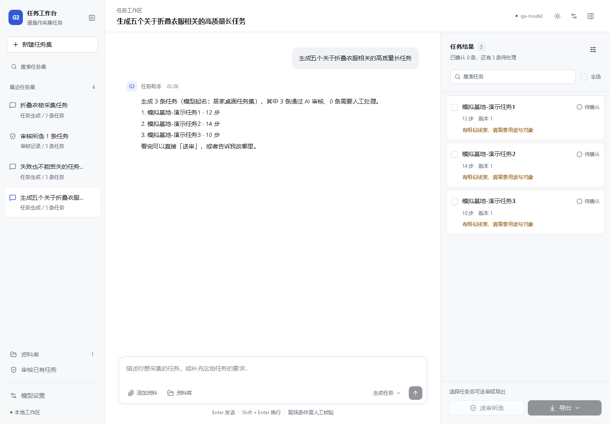
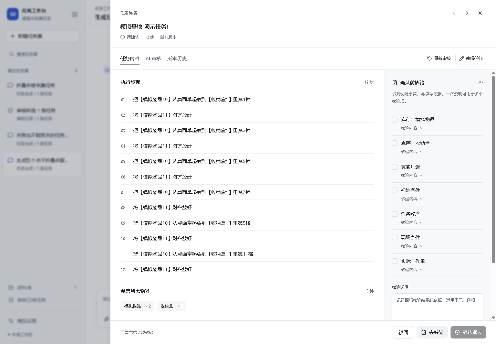
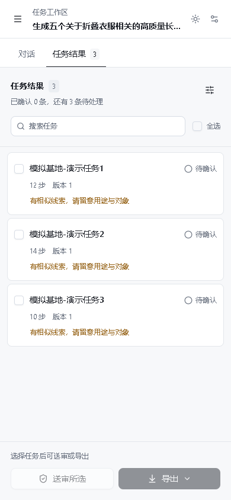
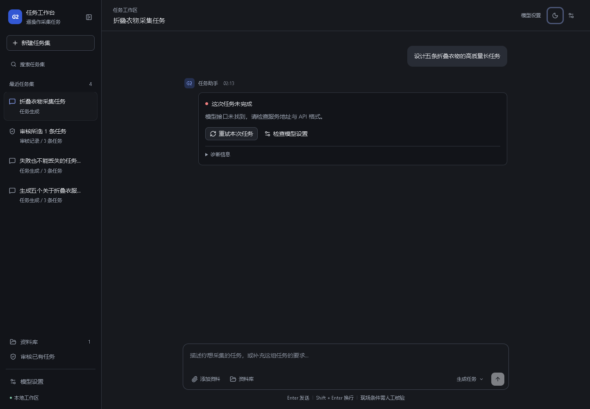

# UI 架构重构验收

2026-11-06。根据用户授权，使用 shadcn/ui 与 AI Elements 重构工作台。保留已有后端接口、任务与版本状态、人工核验和交付门禁；本轮 UI 工作未修改正式模型配置或迁移真实业务库。此前质量修复另见 [质量修复验证记录](./质量修复验证记录.md)。

## 交付

Ant Design 已移除。基础控件使用官方 shadcn/ui，消息区使用官方 AI Elements Conversation、Message、PromptInput；源码纳入项目维护。设计及状态归属见 [前端设计](../frontend/DESIGN.md)，组件适配说明见 [前端维护说明](../frontend/README.md)。

导航可收起，结果区仅在存在任务时展开，窄窗口通过对话与任务页签切换。任务详情以正文、AI 意见、历史和人工核验分层；长步骤列表滚动时保留操作栏。支持浅色、深色、系统主题和减少动态效果。

同一失败作业只在助手结果显示一处错误，技术详情折叠，提供模型设置及原请求重试。发送失败保留文字与附件；保存失败保留编辑；未提交编辑或核验离开时提示。人工逐项勾选后，可用共用说明填充对应证据，也可单项覆盖；没有默认勾选、代填结论或放宽后端门禁。

## 实际验证

| 范围 | 结果 |
|---|---|
| 前端检查 | lint 无警告；typecheck、生产 build 通过 |
| 前端回归 | 7 项通过：消息按作业去重、资料继承、逐项核验映射、错误提示、物料标签与步骤 Diff |
| 后端回归 | `python -m pytest backend/tests -q`，120 项通过 |
| 构建体积 | 主 JS 495.18 KB，gzip 155.55 KB；设置、资料与任务详情延迟加载，无大块警告 |
| 视口 | 390×844、768×1024、1440×1000、1920×1080，无页面横向溢出；工作区与视口等高 |
| 浏览器控制台 | 最终正常流程无 error、warning；注入失败时出现预期的 HTTP 失败日志 |

真实浏览器连接独立临时数据目录的 FastAPI，使用后端 FakeModel，端口 18744；没有调用收费模型。实际覆盖：

- 新需求生成任务，接受后清空草稿；注入发送 503 时保留文字与已上传附件，恢复服务后成功发送。
- 输入法组合事件及 keyCode 229 不发送；Enter/Shift+Enter、页签方向键、导航折叠后的焦点、浮层 Tab 焦点约束与 Escape 关闭。
- 注入版本保存 500 后保留编辑，关闭提示可取消；正常保存新增版本。
- 勾选当前核验项并填写一份共用说明后确认，交付 XLSX 下载成功；旧稿恢复为新版本，核验选择重新清空。
- 所选任务送审；独立审核模型设置保留，保存后密钥输入框清空，未保存设置关闭提示可取消或放弃。
- 隔离库构造 HTTP 404 失败作业，仅显示一个错误块且没有空结果列；重试发送原目标，成功后保留此前失败历史。
- 手机宽度的资料预览、任务详情、核验跳转，以及 34 步长任务完整滚动；底部操作栏保持在视口内。

frontend-craft 静态 UI 审计报告了 outline-none 和按钮类型等启发式提示，不能记为全绿。已检查替代 focus-visible 样式、补充详情页签焦点、设置基础 Button 默认类型，并通过上述实际键盘检查；未关闭审计规则。该检查不能替代完整无障碍审计。

## 截图

截图均为隔离演示数据，不代表真实模型质量或现场能力。

## 边界

未验证真实付费 Provider、真实设备输入法、读屏软件或机器人现场执行。浏览器合成输入法事件不能代表全部物理输入法行为。原截图中的 HTTP 404、超时仍需服务地址、模型及 Provider 实际可用；本轮改善失败反馈与恢复路径，未宣称修复外部模型服务。

当前页面草稿按会话保留，不跨页面刷新持久化。会话和资料列表沿用现有首批 100 条读取方式，本轮没有增加全量分页。所有改动留在工作区，未提交、推送或发布。

组件依据：[shadcn/ui Vite 安装](https://ui.shadcn.com/docs/installation/vite)、[AI Elements 官方仓库](https://github.com/vercel/ai-elements)。
